# Next, Please!

A darkly humorous indie game about occupational health. You are a doctor deciding who is fit for work. Bureaucracy, absurdity, and questionable medical decisions.

The approved visual direction is an old-fashioned institutional clinic. Its setting remains unnamed; the game begins on 3 November 1983. Creative guidance lives in [the art direction](docs/art-direction.md). [FACTS.md](FACTS.md) contains established facts about the game world and explicitly marked open questions.

Created by **[Robert Chaba](https://github.com/robertchaba)**.

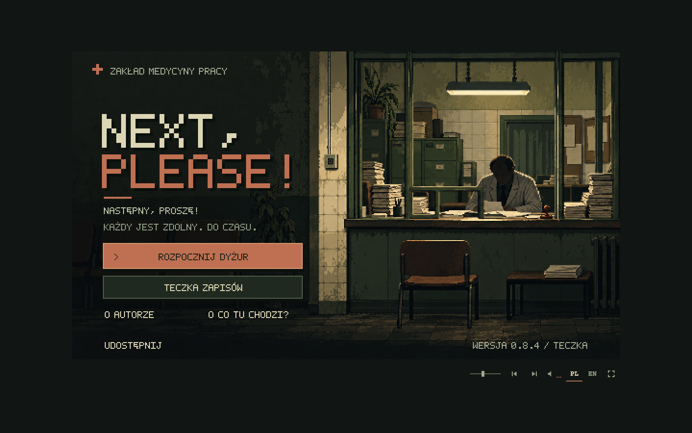

## Run locally

Use Node 22.12+ (Node 22), Node 24, or Node 26+.

```sh
npm ci
npm run dev
```

Open the local address printed by Vite. Build with `npm run build`; serve the result with `npm run preview`. Deploy the contents of `dist/` to any static HTTP(S) host, including a subdirectory. No backend, database, account, or API key is needed. Opening the source HTML directly with `file://` is not supported.

### GitHub Pages

The public game is hosted at **https://robertchaba.github.io/next-please/**. In **Settings → Pages → Build and deployment**, use **Deploy from a branch**, branch **master**, folder **/(root)**. As in `do-nauki`, the repository root contains the compiled site generated by `npm run build`; the source HTML lives in `src/index.html`.

Before each release, run:

```sh
npm ci
npm test
npm run build
npm run test:pages
```

Commit the generated root `index.html`, `favicon.svg`, `assets/` and `.nojekyll` together with source changes, including obsolete bundle deletions, then push `master`. GitHub Pages does not run npm in this mode. `npm run build` first builds the ignored `dist/`, then `scripts/prepare-pages.mjs` refreshes only those generated outputs. Sources stay in `src/` and `public/`, and documentation stays in `docs/`. Original artwork named `*-source*` stays in `public/` and is not duplicated in the root assets. Do not hand-edit generated files.

`npm run test:pages` checks the actual repository root under `/next-please/` using a plain static server, just like Pages. The ordinary browser checks use `dist/`. Vite's relative `base: './'` keeps the build portable to other static hosts.

Play on a desktop computer with a keyboard and mouse. Phones, tablets, and narrow portrait desktop windows receive a separate full-screen telephone vignette: an oversized olive receiver, an exchange tone, rotary dialing, and two brief replies from the clinic. Four presses of **Next** lead to a handwritten **Next, Please!** note explaining that the game requires a desktop. Large pixel-lettered PL / EN and Next controls remain keyboard accessible; a generated speaker icon toggles sound. Sound captions appear only while muted. The loose, untaped note uses enlarged handwriting, and the speech balloon points to the receiver's upper speaker. The mobile view omits the header title and creator footer; Robert Chaba's credit and link remain in the desktop credits. Sound begins only after an unmuted gesture; enable it or tap the receiver to hear the initial tone. The mobile route loads its own generated artwork and two local effects, without starting gameplay or the music playlist. Device detection is stable across rotation. Desktop windows also show the telephone when their width is at most 900 CSS pixels and at most 85% of their height. Widening the window restores the live game without reloading; the phone conversation also keeps its place. Hidden gameplay, shortcuts, and music pause, and preferences follow the visible view. [Mobile artwork and preparation](docs/art-mobile-2026-10-25.md).

## Current build — 1.0.3 / KARTOTEKA

Version 1.0.3 adds Google Analytics through the supplied asynchronous Google tag **G-2MWJLWH08G** on desktop and mobile. The tag is included in the source HTML and generated GitHub Pages build, and also runs on local development/preview pages. Game assets remain local and gameplay works when analytics is unavailable.

Version 1.0.2 gives all eight endings dedicated full-screen artwork, including a new hospital scene. Negative endings play **Game Over - The Final Stamp.mp3**; positive chapter endings play **Victory Fanfare - All Clear.mp3**. The ZUS penalty notice now uses generated perforated carbon-copy paper, a prominent institutional heading, a localized seal and a clear amount. See the [artwork record and previews](docs/art-endings-and-fine-2026-11-01.md). GitHub Pages continues to publish the compiled static build from `master` at `/next-please/`.

The first story chapter spans 26 working days, from 3 November to 8 December 1983. Ten recurring people bring eighteen scheduled visits into the ordinary clinic queue. Their referrals, clinical reports, private notes and institutional letters connect decisions made with the familiar stamps to events outside the consulting room. Every decision still requires a completed certificate handed to the patient; there are no dialogue-choice menus or visible political score bars.

The regional **Kurier Obywatelski / Civic Courier** reports the official account, while the separate weekly **Głos Wzajemności / Voice of Mutuality** responds as the union's printing arrangements permit. Authored reports and the printer's classified replace ordinary slots: each issue retains three or four articles, and an advertising page retains three or four ads. Retained copies preserve their publication, date, content and issue number. Five printed telephone contacts give fixed, case-specific information; ordinary classified calls retain their familiar random replies.

Six illustrated narrative endings join the existing hospital and bankruptcy endings. Three end the game; three finish the chapter and let the doctor begin working day 27 with the same money, records, rules and ongoing examinations. Warnings and final correspondence refer to decisions actually made. Declining or missing a visit changes subsequent events, and no morning paper knows a decision that will occur later that day.

Polish and English include the complete chapter, documents, calls and epilogues. The ten recurring people have fixed identities and dedicated portraits, separate from the 188 ordinary portraits and their alternative identities. The union uses a red **W**, or **M** in English, on its papers and clothing. The country remains unspecified.

Save **v35** preserves chapter decisions, delivered warnings, immutable document evidence, both publications and the epilogue. Earlier saves remain playable with the chapter disabled, so importing an established game does not insert a retroactive history. New games start the chapter. See the [chapter guide and implementation contract](docs/story-1.0.md), [save schema](docs/save-format.md), and [approved narrative specification](external-docs/next-please-specyfikacja-fabuly-codex.md).

## Clinic foundation through 0.8.9 / BIBUŁA

The following records the clinic, interface and background press established before the 1.0 chapter. Version numbers describe their original releases; the current narrative and save contracts above apply to new games.

English now adapts personal names, streets, neighbourhoods and institutions consistently across patients, records, correspondence and the press: Szkolna becomes Alder Street, Osnowa becomes Weft, ZUS becomes SIO and LOT becomes NAL. The [localization guide and complete glossary](docs/localization.md) retain the PL/EN pairs, including historical patient identities. A generated English SIO seal matches the original Polish impression. Case IDs and save v34 remain unchanged.

The [editorial audit](docs/press-editorial-audit.md) covers every Polish and English article and classified: 150 articles rewritten, ten original articles clarified, and 85 ads revised. Reports now identify their schools, clubs, people and circumstances; non-telephone ads give an identifiable contact point. Headings, recurring people and translations were checked together. Catalog IDs, reuse flags, telephone numbers and save v34 remain stable.

**Kurier Obywatelski / Civic Courier** first arrives on the desk on the second working day, 4 November 1983, then every working day. There is no newspaper on 3 November. Warm generated newsprint and separate graphical PL/EN mastheads frame 3–4 regional articles, each read in full in two columns. The compact left-side object has no text overlays. Placing it on the right immediately opens it at 300 × 180, the same size as the rulebook; page turns keep its size. Enter opens it from the left, the corners turn pages, and Escape folds it back onto the left desk. Newspapers can be stored in either drawer, retrieved with their original date/content, or discarded in the basket. New days deliver a fresh copy without replacing retained editions. The drawer holds newspapers in one overlapping stack above the rulebook, with eight editions per batch in publication order. Each exposed edge selects its own issue; hover/focus shows the publication and date above the stack, e.g. “Kurier 04.11.1983” / “Courier 04/11/1983”. Further batches keep every retained issue accessible. The rulebook sits fully inside its right compartment, above the front edge. About 75% of new issues add one final page of 3–4 short classified ads, drawn without requiring a telephone contact; 32 of the 166 catalog entries (19.3%) include a number, with most other ads using in-person messages and only four numbered reply boxes. Selecting a printed number uses the existing telephone (available from the first day), spends three minutes and gives one of six random generic responses. Calls work without a patient and add no medical note or payment. Ads stay with their dated copy through drawers and saves; importing an older save leaves its already printed issues without ads. Reading does not stop time. The accepted [20-article sample](docs/press-sample.md) has been expanded by 150 articles and 150 ads, all in Polish and English. The [catalog](docs/press-catalog.md) now contains 170 articles, 70 reusable after the fresh pool is exhausted (60 of the 150 new articles). Version 1.0 uses the same fixed issue size when inserting authored story reports. [Artwork, prompts and preparation](docs/art-newspaper-2026-10-31.md).

From day two, arrival falls randomly between 07:39 and 07:46. The bell rings before 07:55 but nobody enters; the doctor comments that the waiting room is empty. At 07:55 calls begin without jumping the clock to eight. The first day's 07:57 arrival and first admission at eight remain intact. Save v34 retains the exact issue, publication history and separate press RNG, and supports earlier mornings while preserving strict legacy imports.


The desk now has two identical, independent drawers, with the second between the original drawer and the wastebasket. The player chooses where to keep documents, bundles, the rulebook, loose clips and cash. Both use the same full-screen contents, filing order, pagination and mouse/keyboard actions. Save v34 retains each drawer's contents separately. See [the drawer implementation and artwork record](docs/two-drawers.md).

Borderline findings now permit either decision without ZUS or employer decision penalties: exactly 6 diopters when vision is required, pressure within ±5 of 160/100, and equivocal specialist reports. Approximately one fifth of former refusal cases in fresh queues allow judgement; other contraindications and paperwork duties remain binding. The PL/EN rulebook explains the clinical discretion indirectly. Save v30 appends one discretionary case per identity (IDs 5253–6192), preserving all older cases, reports and queues.

Hypertension certificates identify a named specialist in their letterhead and accessible description. Eight original PL/EN doctor identities are assigned deterministically from the saved telephone contact, so drawers, language changes and older save imports preserve the issuer. See [the name glossary](docs/localization.md).

The additional-examination report now matches the other clinical sheets at 176 × 157. Closed correspondence uses a generated postage stamp on the kraft envelope; see [the artwork record](docs/art-envelope-postage-2026-10-29.md).

- [Revised document design](docs/document-design-2026-10-28.md) uses plain cream paper without the rejected ornamental borders. The original compact document font from before `0732752` is restored throughout; uppercase titles, numbered fields and blue ink distinguish document roles. Militia and LOT have distinct letterheads and larger readable ink impressions; employer stamps name the personnel office. The [rulebook](docs/art-manual-2026-10-28.md) retains its provision numbers, headings and corrected margins and footer. All lettering is upright and supports Polish accents. Referral labels and values share a size and baseline; medical notes have wider line spacing and nine rows per page. The rulebook keeps clear outer and binding margins.
- Additional-examination results are recorded once, in chronological order, when the patient returns. They remain in medical notes after the report is handed back, including archived and later-fetched notes. Longer notes have keyboard-accessible page corners; the full record stays available to assistive technology. Save v34 preserves these entries, the expanded patient catalog and cross-day portrait history; imports of older saves recover historical results only when retained evidence identifies them unambiguously.

- The welcome illustration fills the full 570 × 320 scene without header or footer bars. The clinic name, **Udostępnij / Share** and version sit directly on the original artwork. Its native resolution already fits the viewport, so the approved image needs no regeneration. Sharing passes the current page URL and a clinic joke to the system share sheet; browsers without sharing support copy the link instead. If clipboard access is blocked, a native text dialog lets the player copy the address manually. Cancelling the share sheet leaves the clipboard alone.
- **Instrukcja / Instructions** opens a paper dialog with a beginner's guide to carrying items, the first appointment, filing records, breaks and explicit save files. Share, credits, instructions and the version appear in one line at the bottom of the title screen; keyboard focus moves through the three actions from left to right. The existing generated paper and original bitmap lettering match the credits. Mouse wheel, scrollbar and keyboard scroll the instructions; the Back action stays visible. Escape closes the dialog and returns focus to its link. See the [Polish guide](docs/help-pl-screen.png) and [English guide](docs/help-en-screen.png).
- The displayed version comes from `package.json`. A fixed mathematical rule selects a localized clinic-themed codename for the full version, including its patch number: **1.0.3 / KARTOTEKA** in Polish, **1.0.3 / CARD INDEX** in English. See [versioning](docs/versioning.md) for the formula and stable list.
- Specialists are addressed as colleagues: “Czy kolega potwierdza to zaświadczenie?”. Rotary dialing appears in the existing speech balloon as “Trrr… cyk-cyk-cyk…” (“Whirr… click-click…” in English), alongside the existing local sound.

- Original generated artwork for the title, introduction, cabinet, patients, and tools, with separately rendered pixel lettering and a custom cursor. The “O autorze” / “Credits” sheet names Robert Chaba, links his GitHub profile, and acknowledges support from AI tools in two lines, with Codex, OpenAI models, and Suno below the introduction. Robert’s black-and-white pixel portrait is slightly tilted and attached to the top edge of the credits sheet with a drawn paperclip.
- Polish by default; English available through the PL / EN buttons. The title remains **Next, Please!** in both languages; the Polish welcome screen also displays **Następny, proszę!**.
- Fixed **570 × 320** Canvas 2D graphics on desktop. Whole-number enlargement, nearest-neighbor display, and letterboxing; small desktop windows fit proportionally below 1×. The mobile telephone uses a separate responsive layout.
- Working fullscreen button and **F** shortcut. Use **Tab / Enter** for controls and **Escape** to close a panel.
- Start opens four original illustrated cards: scalpel, catheter, pen, and stamp. Each carries one short sentence and a single **Next** action; the fourth enters the cabinet. Text appears with a mechanical typewriter sound; reduced motion shows it immediately.
- The consulting room fills the canvas with four clearly separated areas: patient against a dark alcove at upper left, examination wall at upper right, a compact exchange shelf at lower left, and the wider document desk at lower right. The left side occupies about 36% of the scene; stamps stand at the far right edge. The two desktop areas are taller than the room views above. A drawn **04** plate identifies the room. Patients emerge from the dark background with a constant head scale and sit down in 720 ms while the background stays still; reduced motion shows the final state immediately. The room begins empty. The lower interface surfaces are the desks, with no extra desk or couch in either upper room; the pendant lamp hangs from the ceiling between the eye chart and clock. Occasional greetings and farewells appear in small comic speech balloons. Most patients stay quiet; refusals end silently, and a failed eye test produces a hesitant reply. Examinations also show a concise result or doctor’s comment for about 1.9 seconds, such as “w normie”, “hmm...” or a pressure reading. Patient details stay on documents, with accessible names and announcements for the controls.
- Click or tap a document, stamp or book once to pick it up; click again to place or use it. Held items follow the pointer. Documents are compact on the left. On the right, referrals, certificates, specialist certificates, medical notes and additional-examination reports share a 176 × 157 format; other papers use 200 × 168. All retain the original text size, and notes paginate after eight body rows. A clipped history sits aligned on top of its equally sized referral. Dropping a sheet near an attached clip joins the documents, with a twelve-pixel margin around the clip. Right-side sheets may overlap the room while at least half remains over the desktop. Handwriting uses muted blue ink, distinct from the dark printed form headings and labels. Documents shrink when lifted from either desktop or the tray, keep their compact footprint while carried, and expand when placed on the right desk. Stamps remain the exception: they grow slightly in hand. Mechanical stamps return to their side rests and stay in hand after stamping, with a short, firm mechanical clack. The rulebook has an unlettered cloth cover: compact on the left shelf, smaller still while carried, and portrait-shaped when resting on the right. Placing it keeps it closed. Page corners appear only while the book rests on the right desk. Its first corner turn opens the cover; subsequent folded page corners navigate nine initial spreads containing 18 numbered clinic regulations, and turning back from the first spread returns to the cover. Annexes arrive on working days 2, 3, 5 and 7, an erratum to the blood-pressure rule on day 4, and a personal-payments supplement on day 6. They remain available at the end of the book; weekends add nothing. The complete edition has seventeen spreads. Future duties are absent from both the initial text and accessible descriptions. The Polish and English text uses serious administrative language, with gameplay inferred from the provisions and humor arising from their bureaucratic precision. The smaller 9-pixel corners are part of the book artwork, with aligned controls and no arrow or close symbols. Paperwork and the rulebook use the restored original font from `0732752^`: five-pixel capitals, four-pixel lowercase and eight-pixel default leading. Referral fields use ten-pixel leading and notes fourteen-pixel leading. Full sheets, book spreads, corrected margins and centered footers remain. There is no coffee cup or pencil. Objects have no hover outlines, while keyboard focus remains visible. With the keyboard, **Tab** to an item, **Space** to lift it, **arrows** to move, **Enter / Space** to use or place it, and **Escape** to cancel. **Shift + arrows** moves faster. **Enter** opens or closes a focused book.
- Daily queues draw from 188 portraits — the three original patients and 185 generated faces — with 168 eligible before working day 7. They normally cap medically unfit patients at 33% of every initial portion (at most 55 of 168 or 62 of 188 overall); the scripted second patient on working day 6 is an exception to the prefix cap. Visits use the bell, eye chart, pressure instrument, and a mechanical scale with a height measure integrated into the examination-room artwork. Examine the patient before or after taking the employer referral. Findings are retained and automatically entered on notes, including sheets fetched later. Take the referral before fetching a separate certificate form from the rack, fill the initially empty patient name and job-position fields together with its pen corner, stamp it, and hand it to the patient. Referrals include the employer, initial/periodic examination, date of birth, sex, occupation, managerial responsibility, working conditions, and hazards. Birth dates and occupations are fixed across each identity’s clinical variants and reflect the intended portrait age; notes calculate the patient’s age on that visit’s date. The certificate holds the patient's identity, job position and fit/unfit decision, without examination results. Both wooden desk fronts share one lower edge; the left front is plain, and the right integrates the drawer and recessed wastepaper opening.
- A compact generated four-slot rack above the stamps on the right supplies blank sheets and certificate forms from its first two slots; the third is stocked with additional-examination referrals from working day 7, and the fourth remains reserved. The rack has no visible captions, while its controls retain localized accessible names. Each sheet is picked up from its slot and carried independently. The slightly tilted paperclip holder beside the telephone supplies clips that can be carried onto a document. Medical notes start with only the patient’s first name, surname and calculated age; completed findings follow as compact entries in examination order. Sheets taken without a patient remain blank until assigned to a visit. The general examination records either no concerns or one of 18 specific physical findings or the occupation-specific psychiatric/radiological concern, stable for that case; vision records a numeric value for each eye, pressure records the first two systolic/diastolic measurements, and weight/height share one row. Repeat pressure measurements vary slightly; further results appear in the brief balloon without replacing either recorded value, including on filed or newly fetched notes. Very high pressure is written in red; unperformed tests reserve no rows. The general examination adds patient history automatically, without a note pen. Every new entry is appended below existing writing, including the second pressure measurement and phone conclusions. Existing rows retain their order through filing, import and later examinations. Drop a sheet onto another sheet's attached clip to form a bundle; click the clip to separate it. Bundles move, file and retrieve together. The note belongs to that patient and day, so later patients cannot overwrite it. Carry paperwork to the drawer to keep it or to the basket to discard it. While carrying compatible items, both drop areas expand around the illustrated openings; the referral can also go directly from its tray to either destination. Keyboard targets expand to the same bounds; open the drawer with an empty hand to see its contents across the full scene. Documents appear as 24 covers per page in filing order, with one cover per clipped bundle. Names appear only on hover or keyboard focus; there is no document preview. The rulebook and loose clips occupy the lower strip. Selecting an item closes the drawer and carries it out; the bottom edge or Escape closes it without retrieving anything. The drawer remains available before, during and after visits. Supplies can be used repeatedly.
- The 188 portraits each have five authored identities with suitable names, professions and ages: 940 people and 5,640 active clinical cases. The latest batch adds 50 civilians with 250 names, occupation and age variants. Earlier batches include ten uniformed militia officers, five uniformed pilots and further civilians, including steelworkers and miners. Uniformed identities always retain their illustrated profession. Each identity has a fixed job and birth date, independent of its five original finding variants and one discretionary variant. The 553 historical case IDs and medical data remain unchanged for imports (6,193 total); selected portrait names were corrected in both dictionaries, including foreign–Polish surnames for women in that group; the catalog now has 48 professions, 27 employers, 16 exposure tags and six work patterns. Each day chooses one identity per portrait, so each face appears once in a newly arranged queue. New queues prioritize faces the player has not seen, then those seen longest ago, using history retained across days and save files. A return after additional testing resumes the same encounter. Saved deterministic randomness chooses the identity and findings; new games get fresh browser entropy. See the [illustrated list of all identities](docs/patient-identities.md). Referrals show a WC/W/C requirement profile. Cases may require both vision and pressure, vision only or pressure only; every profile requires a general examination and body measurements. Click the patient with an empty hand to perform the general examination; abnormal findings require refusal unless a specific applicable specialist report resolves that concern. Mild vision defects remain compatible with work, while significant defects matter for vision profiles. The manual explains the numeric pressure and vision rules. From the fourth working day, a valid specialist certificate can waive the hypertension contraindication for the named job. The refusal stamp is labeled **ODMOWA** in Polish. Existing case IDs and recorded findings remain compatible with old saves; current decision rules also apply to restored visits. See the [catalog authoring guide](docs/patient-catalog.md). These are fictional game rules; weight and height do not introduce medical thresholds. Stamping early and correcting a stamp remain possible. Every completed visit earns a 50 zł bonus paid at home, alongside the 1000 zł daily wage.
- On return from additional examinations, an approval must be handed over paperclipped to the worker’s relevant report. Omitting it always creates a signed reprimand from militia headquarters, the LOT office or the workplace and raises insurance by 50 zł at the 300 zł base rate or 100 zł above it. This consequence also applies alongside a detected medical approval error. Refusals accept the report but do not require it. Handoff removes the certificate and attached reports belonging to this visit; other records stay with the doctor. The day-seven rulebook annex covers delivery and the guaranteed consequence.
- A mistaken approval has a 65% chance of being reported to ZUS: the first detected case that day costs 100 zł and every later one 400 zł. A mistaken refusal is reported in 75% of ordinary cases and 97% of managerial cases; wrongly rejecting an unclear genuine referral from working day 5 instead uses the ZUS 65% path when the patient is otherwise eligible. Detection applies the corresponding consequence and produces a sealed letter from ZUS or the employer. Its envelope appears at least two seconds after handoff, once that patient has finished leaving; the delay pauses with the cabinet presentation. Each sender has six signed variants in both languages, with administrative wording about proceedings and document checks, without descriptions of sanctions; the selected text stays stable across reading, language changes and imports. ZUS uses a blue rectangular seal; employers use a violet circular seal, also found on referrals. Open the folded envelope corner or press Enter, read the paper, and carry it to the wastebasket. Missing examinations alone do not create a complaint when the fit/unfit decision is correct.
- Official letters describe duties and record checks without mentioning sanctions. They add duties by working day, excluding weekends: day 3 checks referrals older than three calendar days; day 4 introduces specialist treatment certificates for hypertension; day 5 checks employer seals and permits HR confirmation. About 5% of referrals are expired, 25% of hypertensive patients whose jobs require normal blood pressure (C or WC) bring specialist certificates, and one third of those certificates name a different job. Vision-only jobs (W) do not generate hypertension certificates for new appointments; existing saved paperwork remains unchanged. Clear seals confirm authenticity, absent seals invalidate a referral, and unclear seals conceal an even split resolved by a call. Ordinary document mistakes use the ZUS penalty schedule and 65% detection probability.
- The second patient on working day 6 offers a 100 zł Waryński banknote for approval of a borderline pressure or vision finding. This scripted encounter is an exception to the usual queue-prefix cap. Later offers target about 10% of all patients. Returning the money and refusing keeps the normal visit bonus; approving the bribing patient has a 30% ZUS detection risk. Keeping the money and refusing causes the hospital ending on the way home. Kept banknotes stay on the desk or in the drawer across visits, can be moved between the two, and become income at day settlement. These choices, each banknote’s location, the daily net cash journal and their pending consequences survive save/import. Pre-v24 saves retain cash already paid, but cannot reconstruct unrecorded historical bribe income.
- Pilots, militia officers, miners and steelworkers are reserved until working day 7. New queues have 168 available portraits before then and all 188 from that day onward; imported queues and existing visits remain intact.
- On working day 7, the Medical Chamber unlocks tonal audiometry for steelworkers, vestibular testing for pilots, psychiatric consultation for militia officers with mental-fitness concerns, and chest X-rays for miners with suspected pneumoconiosis. Take a form from the third rack slot, circle one examination and hand the form to the patient. Their documents and findings remain while further patients are admitted. The patient returns with a clear report after several hours and intervening visits or on the next working day. The report resolves only its specific concern; other medical and document requirements still apply. Referring the wrong occupation always incurs a ZUS fine. Pending visits and results survive save/import.
- The generated dark olive-gray plastic rotary telephone stands at the upper-left corner of the right desktop, projecting above its edge. From the fourth working day it plays a locally synthesized exchange tone; document telephone numbers trigger the existing rotary dialing effect and a short specialist or personnel-department conversation. Calls respect mute and record their conclusions in the notes. The closed rulebook sits near the lower edge of the left desktop; its regulations use impersonal administrative language.
- A plain analog clock with hour and minute hands, without a second hand, starts at **07:57 on day one**, then **07:39–07:46** on later workdays, and visibly advances with each action. Handling, page turns, stamps and decoration changes take one minute; general examination, vision, pressure, and body measurements take three, three, four, and two minutes respectively. Repeated work also takes time. New admissions stop at **14:00**. The clock keeps moving beyond 14:00 while the admitted patient finishes the visit. At **17:00**, a local voice from the corridor calls “zamykamy już!” (“We’re closing now!” in English). At **17:15** the clinic closes, interrupting any unfinished visit without a patient bonus or decision penalty; existing paperwork stays. Handing over the final certificate earlier settles the day automatically, and the home scene follows the patient’s departure without another bell activation. Time also passes continuously while the consulting room or its drawer is active: **30 real seconds = 30 game minutes with a patient, or 5 game minutes without one**. Reading and arranging documents keep this rate; action costs are added independently. Menu panels, hidden tabs and the mobile reception pause the simulation without catching up on return. Reduced motion skips the hand animation but keeps the same time rate.
- Normal examination comments cycle through five localized variants without adjacent repetition, even after the balloon expires or the patient changes. This presentation choice never consumes gameplay randomness.
- After work, separate illustrated cards show the return home, an optional event, a brief budget and the next journey to work. Every card types its comment; Enter reveals the complete current card before advancing. Home cards use the same original font as the welcome screen: 2× titles and narrative text, with native-size budget rows and actions. The budget shows base income, patient bonus, net bribe income when nonzero, previous-day carryover, living costs, fines, insurance, extra expenses and the closing balance. Negative amounts use red ink and a minus sign; retained cash is credited once at settlement, including banknotes left on either desktop. Event cards omit prices; the budget includes their combined cost without penalty formulas. Friday through Sunday use one weekend illustration and comment, followed by one Friday–Sunday summary with summed income and expenses and the opening balance labeled “Sprzed weekendu” / “Before the weekend”. Saved `budgetHistory` retains the earlier daily ledgers until Monday; the comment uses the whole period’s financial result. The following figures document implementation tuning for development. Ordinary living costs are charged and shown from the first day, drawn from 400–800 zł; weekends have the affordability rule below. Daily insurance starts at 300 zł; a detected mistaken refusal adds 50 zł at the base rate or 100 zł at a higher rate. On a day with no increase, the premium falls by 50 zł, stopping at 300 zł. Wages, patient bonuses, living costs, insurance, ZUS fines and any random expense are settled once; the remaining balance carries into the next day.
- Above 2000 zł after ordinary daily costs, the chance of an unexpected medicine, fur-coat, car-repair or home-repair bill grows with savings. The probability and expense ranges are tuning choices recorded in `src/core/economy.ts`; the saved random state makes reopening a save reproduce the same outcome. Weekend events can also be a trip to an unnamed mountain or seaside resort, at most once per weekend. After a Saturday trip, Sunday draws only from ordinary extra expenses; without a Saturday trip, Sunday can still draw either destination. Importing a Saturday save preserves this limit. Already settled historical weekends retain their original events and costs. The clinic closes on Saturday and Sunday and pays no wages or patient bonus. Friday pays the only insurance premium for Friday–Sunday; weekend rates still decay by 50 zł per quiet day, but no premium is charged. Before Saturday, both ordinary weekend living costs are drawn. If their sum exceeds the balance after Friday, the required remaining allowance is max(0, 800 − Friday living cost), split between Saturday and Sunday without a cash cap. Modest Friday–Sunday living costs total 800 zł. If savings plus Friday income cannot cover that amount plus insurance and fines, the first negative daily closing balance causes bankruptcy, even on Saturday or Sunday; exactly zero survives. Otherwise both ordinary 400–800 zł charges apply. Saturday saves Sunday’s allowance, and random expenses cannot spend that reservation. The [modest weekend illustration and joke](docs/art-weekend-modest-2026-10-26.md) appear on the single weekend card when that reduction applies. Monday returns to work without another charge on entry. Bribery begins on the sixth working day. The 1.0 chapter supplies the relationship events described above.
- A negative balance after settlement ends the game in bankruptcy; exactly zero remains playable. The final budget leads to **Ostatni numerek / The last token**: the former doctor now issues cloakroom tokens. Its generated [illustration, source and prompt](docs/art-bankruptcy-2026-10-26.md) match the clinic. **Zacznij od nowa / Start again** directly resets the game, preserving language and audio preferences. The hospital ending takes precedence if already triggered. Terminal states survive import and cannot advance to another day.
- Click the lamp to switch it on/off and the wall decoration to alternate a plant and a certificate. Both changes are saved. **Menu** or **Escape** opens a staff-room break with doctors and nurses talking over coffee, under the same **Next, Please!** title as the welcome screen and without a room caption; Escape first cancels carrying or closes an open book. Resume preserves the visit and desktop, and animations pause during the break. **Start over** asks for confirmation, then returns to the first-day introduction while retaining language and audio settings.
- The game starts on **3 November 1983**. A compact generated calendar beside the paperclip holder sits partly above the rear desk edge and shows a small month and larger dark day number on subdued beige paper, framed by tiny printed side notes and clear paper above and below, without the year; it advances with each new working day. Referrals and correspondence retain their original issue dates and carry references, generated seals and signatures; medical notes remain compact handwritten entries. Certificates use distressed generated ZDOLNY/ODMOWA and FIT/REFUSAL impressions, chosen by language. Referral dates and authenticity become enforceable through the new daily letters. Patient names, jobs and simplified examination findings are playable fictional content. The 1.0 chapter adds the story events described above; further chapters and additional instruments are undecided.
- The secretary hands over documents in the new save-screen illustration. Export and import transfer real progress as a compressed version 34 `.npsave` file, including intro position, tests, the first two pressure findings and latest measurement, applied stamp (also before examinations), clock, daily queue, cross-day portrait history, random state, newspaper issue, publication history and retained dated copies, insurance premium, daily penalties, settled budget, earlier weekend ledgers and reserved Sunday living cost, previous-month carryover, decoration, notes, referrals, opened/sealed letters, clip bundles, manually written certificate names and job positions, append-only note entry order, pending additional examinations and returns, endings, and drawer documents, rulebook and loose clips. Item positions, stacking order, open book/newspaper and selected page, clock interpolation, the elapsed clock’s sub-minute remainder, patient movement and speech are temporary: a successful import resets them while restoring the saved appointment; a failed import preserves the live state. Version 1 sample saves migrate to an empty cabinet with their counters preserved. Version 2–23 progress remains importable with their existing clock values; saves on either removed intro card continue into the cabinet. Imports validate completely before replacing state. Only language, mute, and music volume preferences use browser storage; export before closing or reloading.
- Seventeen local music tracks play in a repeating ordinary playlist across the title screen, introduction, clinic panels, and cabinet. Ordinary home/day settlement uses only **Wissenschaftlicher Optimismus - Feierabend.mp3**; hospital, bankruptcy and all three negative chapter endings use only **Game Over - The Final Stamp.mp3**. The three positive chapter endings use **Victory Fanfare - All Clear.mp3**, then restore ordinary music when work continues. The failure cue never enters the ordinary playlist, including previous/next navigation. Previous/next controls stay within the active context, mute is preserved, and restarting returns to ordinary music. Both ending cues stay outside the ordinary and home playlists. The older victory duplicate was removed. All twenty MP3s share the [soundtrack metadata and supplied album cover](public/assets/audio/music/README.md#album-metadata). Audio starts muted: enable it with the speaker button. Use the previous/next buttons beside it to change tracks, wrapping at either end without changing mute. Before playback begins, those buttons select the starting track without loading audio. A saved unmuted preference starts music on the first click or key press after reloading. Opening panels does not restart the music.

- Weekend scenes follow the saved in-game date. Nine additional generated illustrations cover autumn/rainy/winter/spring/summer outings, winter seaside trips, reading, radio and cooking. A single neutral mountain view is used all year. Golden autumn is available October 1–November 15; winter scenes December–February; spring March–May; summer June–August; rainy tram scenes March–April and September–November. Indoor scenes remain available all year. The nine active new scenes have two comments each in PL/EN; the eight existing weekend/event comments have been revised. Selection derives from the saved day and RNG without consuming a draw or changing costs. See the [scene catalog, captions and preview galleries](docs/art-weekends-seasonal-2026-10-30.md).

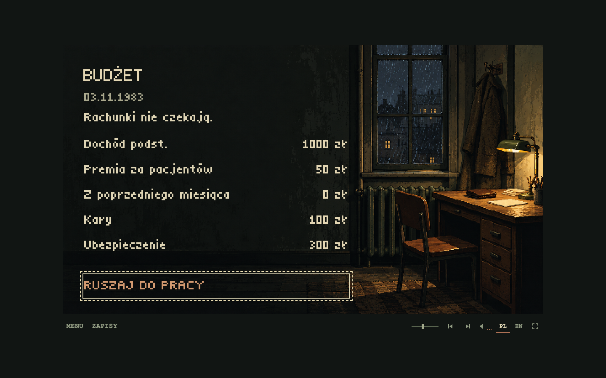

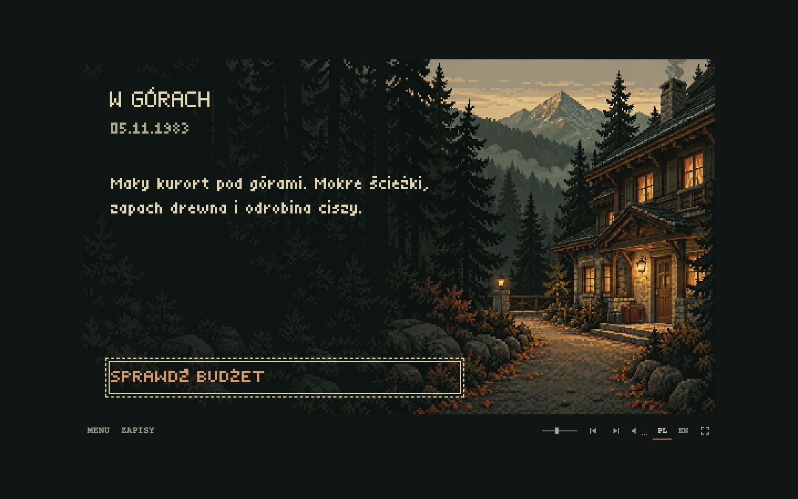

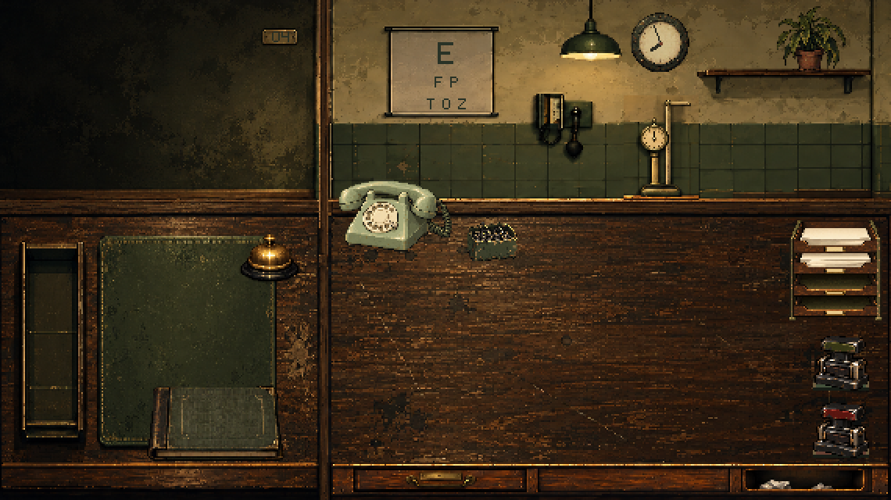

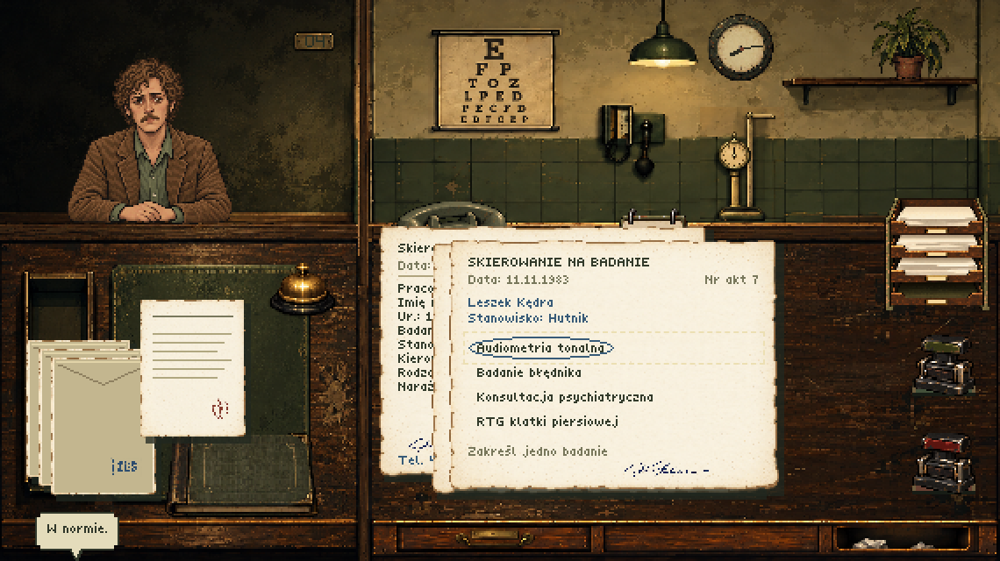

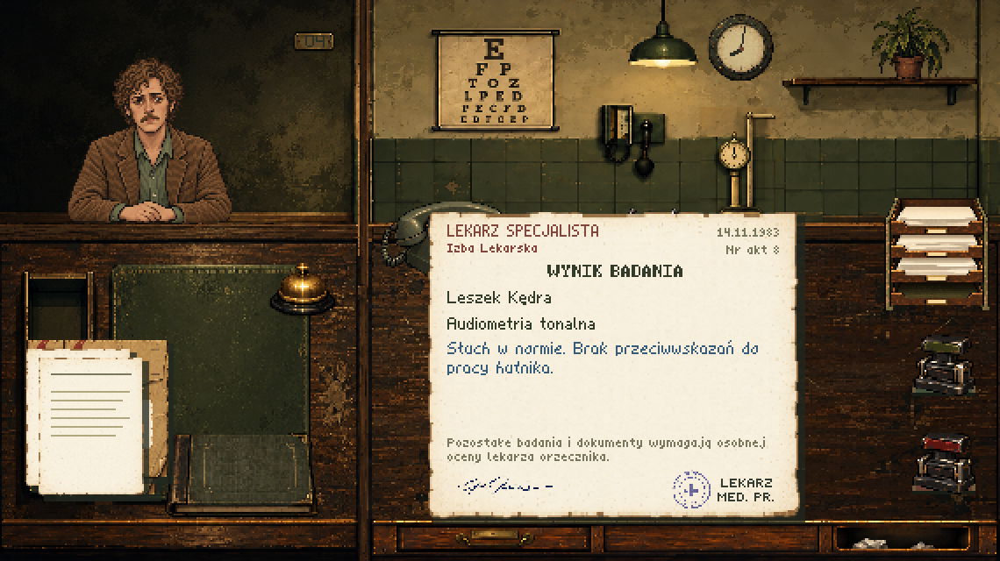

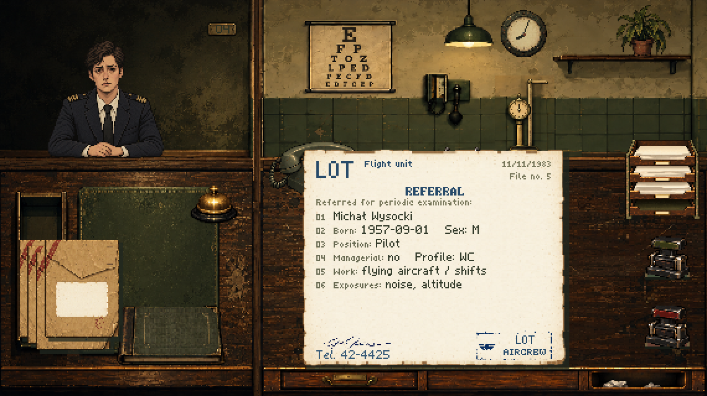

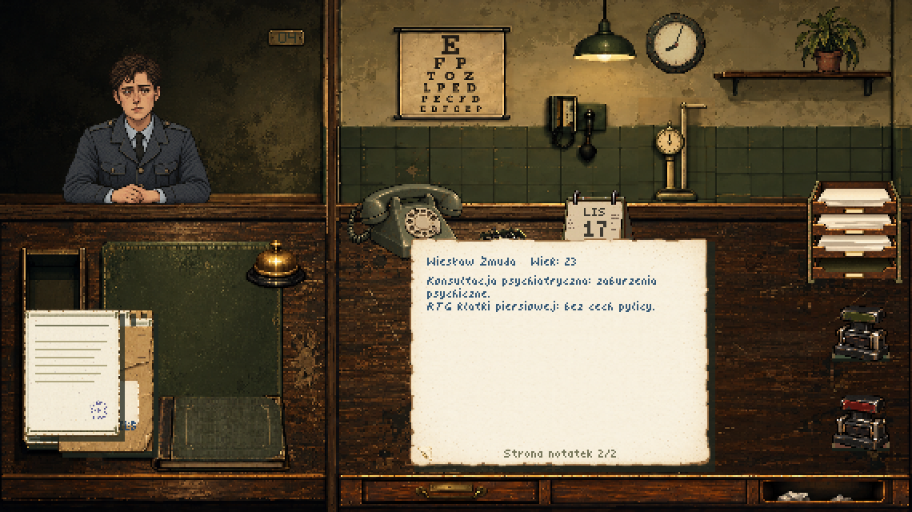

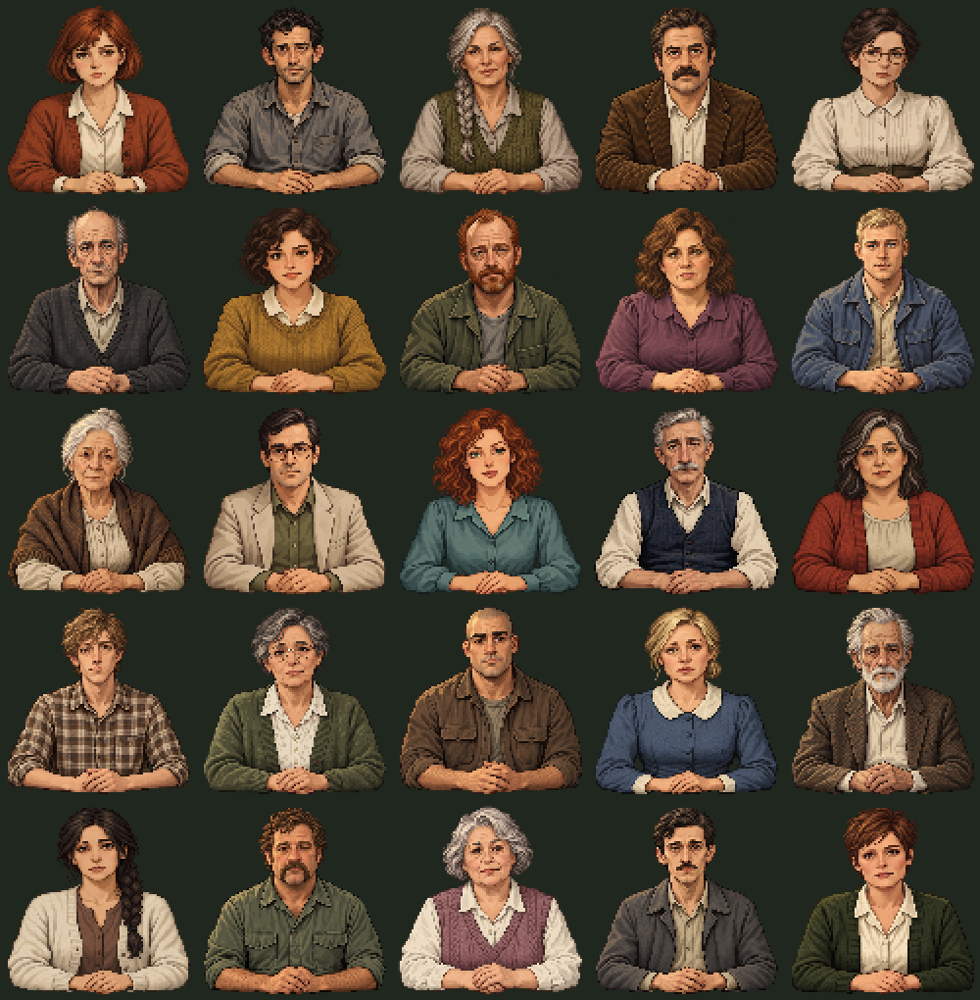

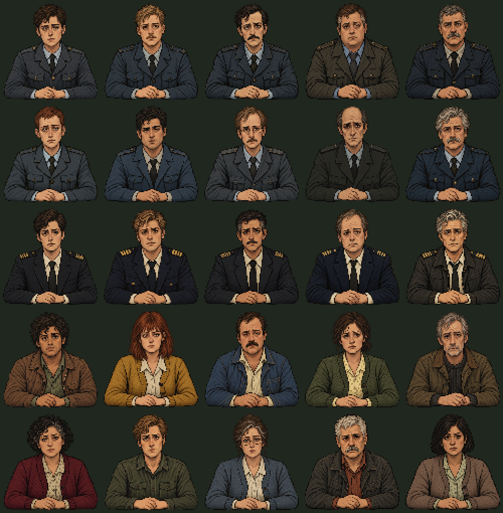

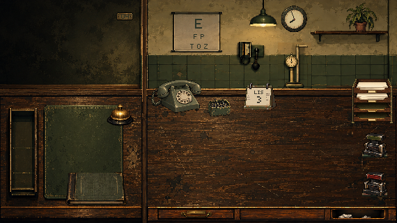

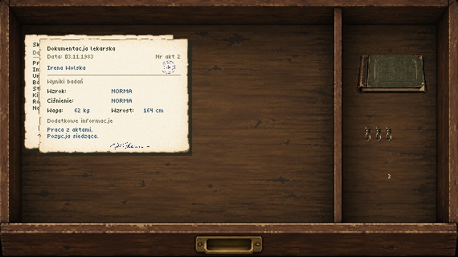

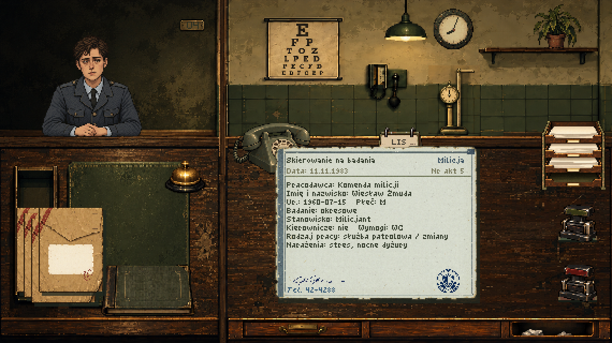

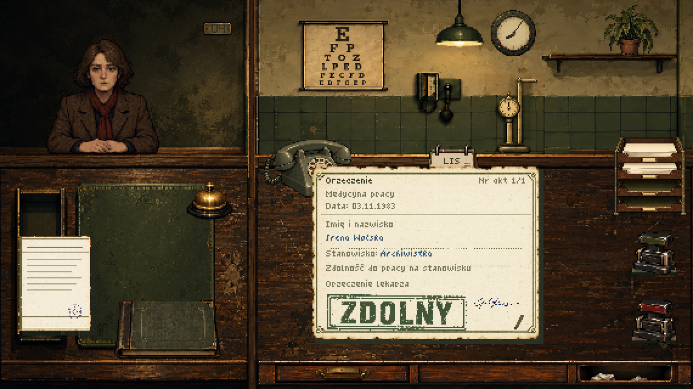

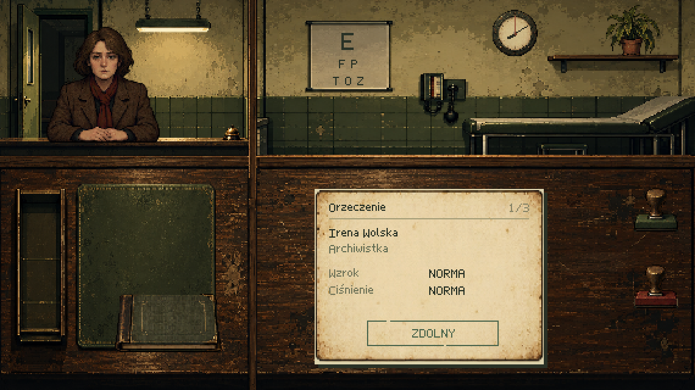

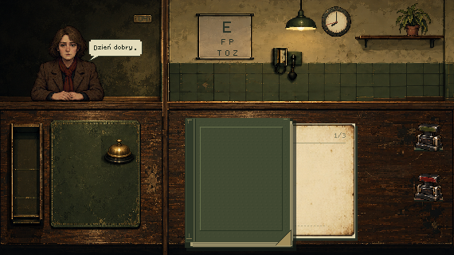

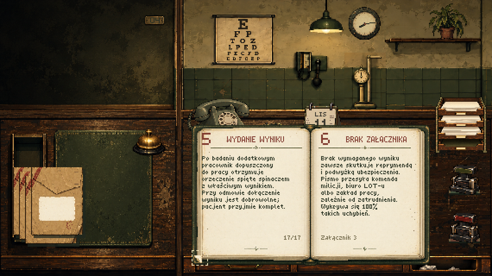

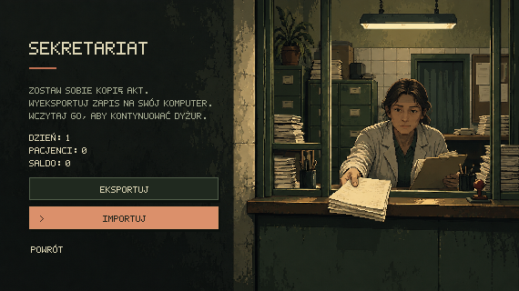

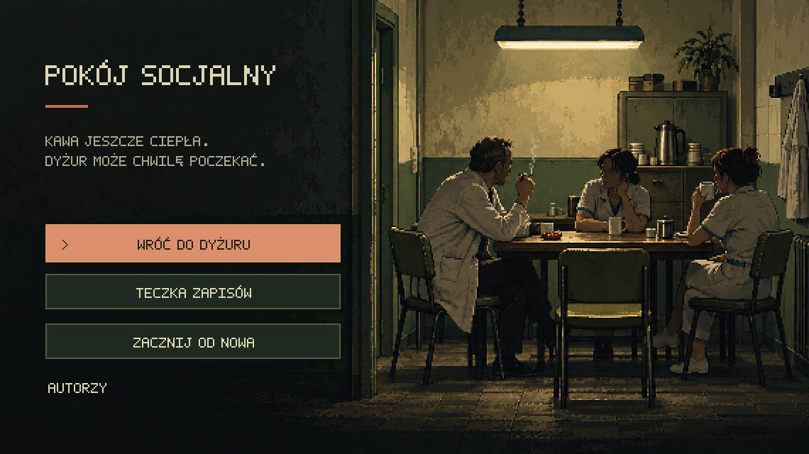

The typewriter, carriage return, paper handling, stamp, desk-bell, desktop telephone, and mobile exchange/dialing effects are original offline syntheses, stored as local WAVs. The 260 ms mechanical stamp effect combines a dry rubber-and-wood impact, faint mechanism slide and a separate quiet return clack; the desk bell rings for 680 ms. Enable sound with the speaker button; the saved mute preference applies to effects and music together. Recreate the WAVs with `node scripts/generate-effects.mjs`; the generator and provenance are included in the [audio notes](public/assets/audio/README.md).

Music lives in [`public/assets/audio/music/`](public/assets/audio/music/) and is registered in `src/core/music.ts`. The folder's [notes](public/assets/audio/music/README.md) record the track list and pending provenance. Add source assets here, not in the generated `dist/` folder, which is replaced on each build.

Language, fullscreen, music, and cabinet menu/save controls sit below the 570 × 320 scene, including in fullscreen. There is no title or department text above the scene; the PL / EN controls use a 14px font, and Menu / Saves use a larger 16px font. They remain keyboard accessible and are included in the display fitting calculation. The compact music controls include a volume slider (0–100%, initially 40%) that remembers its setting. Drag it or focus it and use the arrow keys; Home/End select the minimum/maximum. Volume changes preserve mute. Three tiny bars beside the speaker respond to the audio during audible playback; reduced-motion preferences keep the indicator static.

All runtime assets are local. There are no external runtime requests; following the GitHub credit is the only external navigation. Offline caching is not configured.

## Project map

| Location | Purpose |
| --- | --- |
| `src/main.ts` | Startup device detection and lazy selection of desktop or mobile entry point |
| `src/desktop.ts` | Desktop scene transitions, typewriter, patient movement and speech updates, panels, semantic controls, and integration |
| `src/mobile.ts` | Mobile telephone sequence, semantic controls, preferences, and gesture-triggered sound |
| `src/core/device.ts` | Pure mobile-device classification and browser capability detection |
| `src/render/mobile.ts` | Generated mobile note and balloon composition with localized bitmap lettering |
| `src/core/calendar.ts` | Deterministic civil dates derived from the saved day, starting 3 November 1983 |
| `src/render/drawer.ts` | Full-scene drawer contents, insertion order, separate object compartment and aligned controls |
| `src/core/clock.ts` | Monotonic elapsed-time accumulation, patient/empty rates and pause handling |
| `src/core/game.ts` | Pure gameplay actions, consequences, day transitions, and simulated shift time |
| `src/core/patients.ts` | Stable character/case catalog, saved random sequence, and daily roster generation |
| `src/core/story.ts` | Chapter state, ordered decision ledger, hidden scores, warnings and endings |
| `src/core/story-patients.ts` | Ten fixed people and eighteen scheduled clinical cases |
| `src/core/story-content.ts` | Authored documents, immutable evidence snapshots and deterministic contacts |
| `src/core/story-publications.ts` | Dated story reports, weekly publication queue and causality validation |
| `src/core/story-integration.ts` | Roster, document delivery, completed visits and settlement integration |
| `src/render/story-paper.ts` | Full paginated story documents and their accessible descriptions |
| `src/scenes/epilogue.ts` | Illustrated narrative endings, final documents and chapter continuation |
| `src/core/progression.ts` | Working-day duties, generated referral/specialist facts and bribery eligibility |
| `src/core/economy.ts` | Wages, living costs, insurance, fines, and random expense settlement |
| `src/scenes/home.ts` | Illustrated home/event/budget/departure cards and enlarged localized typewriter text |
| `src/core/desk.ts` | Temporary item positions, desktop bounds, and stacking order |
| `src/core/desk-input.ts` | Shared mouse, touch, and keyboard item movement |
| `src/scenes/shift.ts` | Intro/cabinet presentation and item hit areas |
| `src/render/clinic.ts` | Local generated artwork loading and composition, patient sprites, and analog clock |
| `src/render/paperwork.ts` | Referrals, notes, envelopes, complaint letters, and their accessible descriptions |
| `src/core/manual.ts` | Working-day availability of rulebook annexes and errata |
| `src/render/manual.ts` | Physical rulebook cover, current edition, page corners and accessible page descriptions |
| `src/i18n.ts` | Polish and English strings; optional preferences |
| `src/render/font.ts` | Original title and compact document bitmap lettering with Polish diacritics |
| `src/core/display.ts` | Native resolution, scaling, and cursor |
| `src/core/save.ts` | Validated gzip JSON save format and browser file operations |
| `src/core/audio.ts` | Lazy Howler audio registry and playback controls |
| `src/core/music.ts` | Local music manifest and ordinary/home/game-over/victory playlists |
| `src/core/effects.ts` | Local mechanical effects, desktop telephone, and mobile exchange/dialing sounds |
| `public/assets/` | Local art and audio |

The runtime uses **fflate** and **Howler**. **Vite**, **TypeScript**, **Vitest**, and **Playwright** are development tools. The committed lockfile pins the installed dependencies.

## Documentation

- [First story chapter and 1.0 contracts](docs/story-1.0.md)
- [Game-world facts and open questions](FACTS.md)
- [Technical guidelines](docs/technical-guidelines.md)
- [Save schema and migration rules](docs/save-format.md)
- [Art direction, generation prompt, and provenance](docs/art-direction.md)
- [Archive and staff-room artwork, exact prompts and preparation](docs/art-panels-2026-10-24.md)
- [Neutral secretary expression revision](docs/art-nurse-revision-2026-10-24.md)
- [Creator portrait, permission and exact prompt](docs/art-creator-2026-10-24.md)
- [Generated telephone, scale and paperclips](docs/art-workstation-2026-10-25-assets.md)
- [Generated document rack, paper and integrated desk edge](docs/art-workstation-2026-10-25-stationery.md)
- [Workstation polish: integrated scale and aligned desk fronts](docs/art-workstation-2026-10-25-polish.md)
- [Current corrections: darker turned telephone, raised rack, and clean desk edge](docs/art-workstation-2026-10-25-corrections.md)
- [Drawer, calendar, localized ink impressions, seals and signatures](docs/art-drawer-documents-2026-10-25.md)
- [Separate ZUS and employer seals](docs/art-sender-seals-2026-10-25.md)
- [Revised tear-off calendar with side printing](docs/art-calendar-revision-2026-10-25.md)
- [Complete generated eye chart with printed letters](docs/art-eye-chart-2026-10-25.md)
- [Mobile handset, speech balloon and note: sources, prompts and preparation](docs/art-mobile-2026-10-25.md)
- [New patients and evening artwork: sources, prompts and preparation](docs/art-economy-2026-10-25.md)
- [Patient portraits 51–75: names, ages, prompts and preparation](docs/art-patients-2026-10-26.md)
- [Patient portraits 111–135: sources, prompts and preparation](docs/art-patients-111-135-2026-10-28.md)
- [Patient portraits 136–185: sources, prompts and preparation](docs/art-patients-136-185-2026-10-29.md)
- [Envelope postage stamp: source, prompt and preparation](docs/art-envelope-postage-2026-10-29.md)
- [Adding music and sound effects](public/assets/audio/README.md)
- [Repository instructions](AGENTS.md)

## Verify

```sh
npm test
npm run build
npm run test:browser
```

Browser checks use Playwright with installed Google Chrome against the built static site. Alternatively, run `npx playwright install chromium` and remove `channel: 'chrome'` from `playwright.config.ts` to use Playwright's bundled Chromium. Screenshots and downloaded test saves are written under the ignored `test-results/` directory.

Every new graphical element is generated, as required by `AGENTS.md` and the art direction; Canvas geometry is reserved for localized text and changing presentation marks. The title, cabinet, introduction, archive, staff-room illustrations, and transparent sprites were generated specifically for this project with the built-in OpenAI image generator. Prompts, original sources, and preparation details are retained in the art documentation. Runtime images and sprites live in `public/assets/art/`. Text remains a separate layer except for the four generated PL/EN decision impressions; each language selects its matching original ink asset. The pixel font, cursor, and interface are original code. Acquired assets must include their source, author, license, and required attribution; see the technical guidelines.

## Records inspections and expanded archive

From working day two, seeded ZUS inspections occur with a 1/25 probability per newly completed patient visit. Three generated inspectors show an identity card before requesting the referral and medical note for an exact visit from the last 25 completions, including earlier days. Hand over sheets separately or as a bundle. Two empty-hand conversations confirm missing records: 200 zł for neither sheet, 50 zł for one; a generated penalty notice records the charge in the daily budget. Returning both sheets closes the inspection without a fine. Checked documents remain on the desk.

The drawer shows up to 24 generated covers per page, with one position per clipped bundle. Names appear on hover or keyboard focus; document previews are disabled. Filing order, clipped bundles and access to every retained sheet are preserved. The base rulebook explicitly requires filing referrals with visit notes; a second-working-day supplement explains inspections. The budget separates its closing balance with a short rule and warmer lettering.

The inspection expansion added ten civilian portraits, bringing the cast at that point to 113 with five authored identities each (565 total), stable birth dates and professions. Source artwork, prompts and offline preparation are retained in the [inspection and patient artwork record](docs/art-inspection-2026-10-27.md). Save v26 preserves inspection progress, fine totals and recent visits; older saves migrate without inventing visit history. The game remains static and client-side.

## Patient library expansion

The 0.8 series added 50 generated civilian portraits (`patient-136`–`patient-185`), bringing the ordinary library to 188 faces and 940 authored identities. Version 1.0 adds ten separate, fixed story identities. Each new face has five distinct names, suitable professions and stable birth dates, with Polish and English paperwork. Existing cases 0–4002 remain unchanged; new cases append IDs 4003–5252. Save v29 adds cross-day portrait history and accepts the expanded catalog while earlier save versions retain their original bounds and imported queues. Sources, exact prompts, the reproducible preparation script and the visual roster are retained in the [artwork record](docs/art-patients-136-185-2026-10-29.md).
