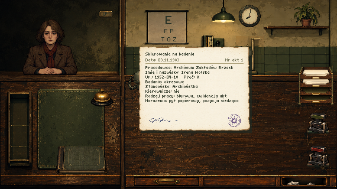
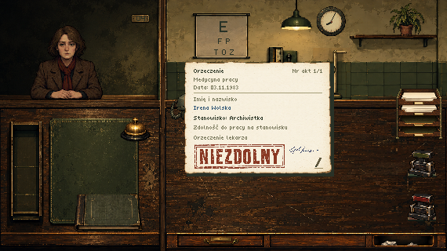
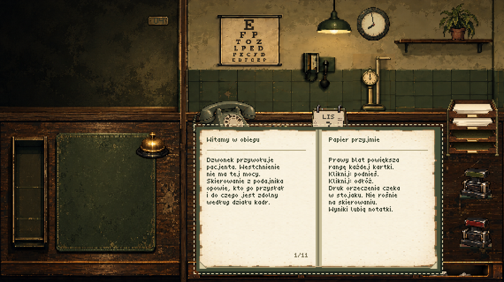

# Next, Please!

A darkly humorous indie game about occupational health. You are a doctor deciding who is fit for work. Bureaucracy, absurdity, and questionable medical decisions.

The approved visual direction is an old-fashioned institutional clinic. Its setting remains unnamed; the game begins on 3 November 1983. Creative guidance lives in [the art direction](docs/art-direction.md). [FACTS.md](FACTS.md) contains established facts about the game world and explicitly marked open questions.

Created by **[Robert Chaba](https://github.com/robertchaba)**.


## Run locally

Use Node 22.12+ (Node 22), Node 24, or Node 26+.

```sh
npm ci
npm run dev
```

Open the local address printed by Vite. Build with `npm run build`; serve the result with `npm run preview`. Deploy the contents of `dist/` to any static HTTP(S) host, including a subdirectory. No backend, database, account, or API key is needed. Opening the source HTML directly with `file://` is not supported.

Play on a desktop computer with a keyboard and mouse. Phones, tablets, and narrow portrait desktop windows receive a separate full-screen telephone vignette: an oversized olive receiver, an exchange tone, rotary dialing, and two brief replies from the clinic. Four presses of **Next** lead to a handwritten **Next, Please!** note explaining that the game requires a desktop. Large pixel-lettered PL / EN and Next controls remain keyboard accessible; a generated speaker icon toggles sound. Sound captions appear only while muted. The loose, untaped note uses enlarged handwriting, and the speech balloon points to the receiver's upper speaker. The mobile view omits the header title and creator footer; Robert Chaba's credit and link remain in the desktop credits. Sound begins only after an unmuted gesture; enable it or tap the receiver to hear the initial tone. The mobile route loads its own generated artwork and two local effects, without starting gameplay or the music playlist. Device detection is stable across rotation. Desktop windows also show the telephone when their width is at most 900 CSS pixels and at most 85% of their height. Widening the window restores the live game without reloading; the phone conversation also keeps its place. Hidden gameplay, shortcuts, and music pause, and preferences follow the visible view. [Mobile artwork and preparation](docs/art-mobile-2026-10-25.md).

## Current build — 0.7: expanded patients, daily life and weekends

- Original generated artwork for the title, introduction, cabinet, patients, and tools, with separately rendered pixel lettering and a custom cursor. The “O autorze” / “Credits” sheet names Robert Chaba, links his GitHub profile, and acknowledges support from AI tools in two lines, with Codex, OpenAI models, and Suno below the introduction. Robert’s black-and-white pixel portrait is slightly tilted and attached to the top edge of the credits sheet with a drawn paperclip.
- Polish by default; English available through the PL / EN buttons. The title remains **Next, Please!** in both languages; the Polish welcome screen also displays **Następny, proszę!**.
- Fixed **570 × 320** Canvas 2D graphics on desktop. Whole-number enlargement, nearest-neighbor display, and letterboxing; small desktop windows fit proportionally below 1×. The mobile telephone uses a separate responsive layout.
- Working fullscreen button and **F** shortcut. Use **Tab / Enter** for controls and **Escape** to close a panel.
- Start opens four original illustrated cards: scalpel, catheter, pen, and stamp. Each carries one short sentence and a single **Next** action; the fourth enters the cabinet. Text appears with a mechanical typewriter sound; reduced motion shows it immediately.
- The consulting room fills the canvas with four clearly separated areas: patient against a dark alcove at upper left, examination wall at upper right, a compact exchange shelf at lower left, and the wider document desk at lower right. The left side occupies about 36% of the scene; stamps stand at the far right edge. The two desktop areas are taller than the room views above. A drawn **04** plate identifies the room. Patients emerge from the dark background with a constant head scale and sit down in 720 ms while the background stays still; reduced motion shows the final state immediately. The room begins empty. The lower interface surfaces are the desks, with no extra desk or couch in either upper room; the pendant lamp hangs from the ceiling between the eye chart and clock. Occasional greetings and farewells appear in small comic speech balloons. Most patients stay quiet; refusals end silently, and a failed eye test produces a hesitant reply. Patient details stay on documents, with accessible names and announcements for the controls.
- Click or tap a document, stamp or book once to pick it up; click again to place or use it. Held items follow the pointer. Documents are compact on the left and full size on the right desk. Right-side sheets may overlap the room while at least half remains over the desktop. Handwriting uses muted blue ink, distinct from the dark printed form headings and labels. Documents shrink when lifted from either desktop or the tray, keep their compact footprint while carried, and expand when placed on the right desk. Stamps remain the exception: they grow slightly in hand. Mechanical stamps return to their side rests and stay in hand after stamping, with a short, firm mechanical clack. The rulebook has an unlettered cloth cover: compact on the left shelf, smaller still while carried, and portrait-shaped when resting on the right. Placing it keeps it closed. Page corners appear only while the book rests on the right desk. Its first corner turn opens the cover; subsequent folded page corners navigate eight instructional spreads, and turning back from the first spread returns to the cover. The smaller 9-pixel corners are part of the book artwork, with aligned controls and no arrow or close symbols. An original seven-row document face with five-pixel capitals and an eight-pixel line advance keeps paperwork compact in both languages. There is no coffee cup or pencil. Objects have no hover outlines, while keyboard focus remains visible. With the keyboard, **Tab** to an item, **Space** to lift it, **arrows** to move, **Enter / Space** to use or place it, and **Escape** to cancel. **Shift + arrows** moves faster. **Enter** opens or closes a focused book.
- A fully shuffled daily queue of 53 characters — the three original patients and 50 generated faces — uses the bell, eye chart, pressure instrument, and a mechanical scale with a height measure integrated into the examination-room artwork. Take the employer referral, examine the patient, fetch a separate certificate form from the rack, enter the patient name with its pen corner, stamp it, and hand it to the patient. Referrals include the employer, initial/periodic examination, date of birth, sex, occupation, managerial responsibility, working conditions, and hazards. The certificate holds the patient's identity and fit/unfit decision, without examination results. Both wooden desk fronts share one lower edge; the left front is plain, and the right integrates the drawer and recessed wastepaper opening.
- A compact generated four-slot rack above the stamps on the right supplies blank sheets and certificate forms from its two active slots; two empty slots are reserved for later document types. The rack has no visible captions, while its controls retain localized accessible names. Each sheet is picked up from its slot and carried independently. The slightly tilted paperclip holder beside the telephone supplies clips that can be carried onto a document. A blank medical sheet receives only completed findings: the patient name followed by compact entries in examination order. The general examination records concerns or their absence, vision records a numeric value for each eye, pressure records systolic/diastolic values, and weight/height share one row. Very high pressure is written in red; unperformed tests reserve no rows. The pen corner (or Enter) adds supplementary information. Drop a sheet onto another sheet's attached clip to form a bundle; click the clip to separate it. Bundles move, file and retrieve together. The note belongs to that patient and day, so later patients cannot overwrite it. Carry paperwork to the drawer to keep it or to the basket to discard it. While carrying compatible items, both drop areas expand around the illustrated openings; the referral can also go directly from its tray to either destination. Keyboard targets expand to the same bounds; open the drawer with an empty hand to see its contents across the full scene. Documents overlap in insertion order; large piles can be browsed in groups of twelve, without sorting or search. The rulebook and loose clips occupy a separate compartment. Selecting an item closes the drawer and carries it out; the bottom edge or Escape closes it without retrieving anything. The drawer remains available before, during and after visits. Supplies can be used repeatedly.
- The catalog contains 328 stable cases, 32 professions, 20 employers, 15 exposure tags and six work patterns. The 25 newest identities each have nine variants, including a general-examination concern. Each day shuffles all identities, including the first three, and chooses one variant per person using saved deterministic randomness; new games get fresh browser entropy. Referrals show a WC/W/C requirement profile. Cases may require both vision and pressure, vision only or pressure only; every profile requires a general examination and body measurements. Click the patient with an empty hand to perform the general examination; any concern requires refusal. Mild vision defects remain compatible with work, while significant defects matter for vision profiles. The manual explains the numeric pressure and vision rules. No pilots or specialist consultations are implemented. The refusal stamp is labeled **ODMOWA** in Polish. Existing case IDs and their decisions remain compatible with old saves. See the [catalog authoring guide](docs/patient-catalog.md). These are fictional game rules; weight and height do not introduce medical thresholds. Stamping early and correcting a stamp remain possible. Every completed visit earns a 50 zł bonus paid at home, alongside the 1000 zł daily wage.
- A mistaken approval has a 65% chance of being reported to ZUS: the first detected case that day costs 100 zł and every later one 400 zł. A mistaken refusal is reported in 75% of ordinary cases and 97% of managerial cases. Detection produces a sealed letter from ZUS or the employer and applies the corresponding consequence. Each sender has six signed variants in both languages, with indirect administrative wording about proceedings, fees or insurance; the selected text stays stable across reading, language changes and imports. ZUS uses a blue rectangular seal; employers use a violet circular seal, also found on referrals. Open the folded envelope corner or press Enter, read the paper, and carry it to the wastebasket. Missing examinations alone do not create a complaint when the fit/unfit decision is correct.
- The generated dark olive-gray plastic rotary telephone stands at the upper-left corner of the right desktop, projecting above its edge. It plays a locally synthesized exchange tone, respecting mute; calling remains unavailable. The closed rulebook sits near the lower edge of the left desktop. Checking seals/stamps and further document types are planned, with rules still undecided.
- A plain analog clock with hour and minute hands, without a second hand, starts at **07:57** and visibly advances with each action. Handling, page turns, stamps and decoration changes take one minute; general examination, vision, pressure, and body measurements take three, three, four, and two minutes respectively. Repeated work also takes time. New admissions stop at **14:00**. A patient admitted before closing can finish every examination and receive the certificate even after the clock reaches 14:00; handing over that certificate settles the day automatically, and the home scene follows the patient’s departure without another bell activation. Time advances through actions, not through a real-time countdown. Reduced motion skips the hand animation.
- After work, separate illustrated cards show the return home, an optional event, a brief budget and the next journey to work. Every card types its comment; Enter reveals the complete current card before advancing. Home cards use the same original font as the welcome screen: 2× titles and narrative text, with native-size budget rows, dates and actions. The six budget rows show base income, patient bonus, previous-month carryover, living costs, fines and insurance. Event costs and penalty formulas stay out of player-facing copy. Previous-month carryover is a saved month-opening snapshot, not yesterday’s balance. The following figures document implementation tuning for development. Living costs are charged and shown from the first day, drawn once from 400–800 zł. Daily insurance starts at 300 zł; a detected mistaken refusal adds 50 zł at the base rate or 100 zł at a higher rate. On a day with no increase, the premium falls by 50 zł, stopping at 300 zł. Wages, patient bonuses, living costs, insurance, ZUS fines and any random expense are settled once; the remaining balance carries into the next day.
- Above 2000 zł after ordinary daily costs, the chance of an unexpected medicine, fur-coat, car-repair or home-repair bill grows with savings. The probability and expense ranges are tuning choices recorded in `src/core/economy.ts`; the saved random state makes reopening a save reproduce the same outcome. Weekend events can also be a trip to an unnamed mountain or seaside resort. The current provisional weekend model closes the clinic on Saturday and Sunday, pays no wages or patient bonus, and settles household costs once per day; Monday returns to work. Weekend pay and closure are implementation assumptions awaiting further story/rule design. Story bribes and relationship events are deferred.
- Click the lamp to switch it on/off and the wall decoration to alternate a plant and a certificate. Both changes are saved. **Menu** or **Escape** opens a staff-room break with doctors and nurses talking over coffee, under the same **Next, Please!** title as the welcome screen and without a room caption; Escape first cancels carrying or closes an open book. Resume preserves the visit and desktop, and animations pause during the break. **Start over** asks for confirmation, then returns to the first-day introduction while retaining language and audio settings.
- The game starts on **3 November 1983**. A compact generated calendar beside the paperclip holder sits partly above the rear desk edge and shows a small month and larger dark day number on subdued beige paper, framed by tiny printed side notes and clear paper above and below, without the year; it advances with each new working day. Referrals and correspondence retain their original issue dates and carry references, generated seals and signatures; medical notes remain compact handwritten entries. Certificates use distressed generated ZDOLNY/ODMOWA and FIT/REFUSAL impressions, chosen by language. Authenticity-checking rules remain undecided. Patient names, jobs and simplified examination findings are playable fictional content. Story, bribes, relationship details and additional instruments remain future work.
- The secretary hands over documents in the new save-screen illustration. Export and import transfer real progress as a compressed version 11 `.npsave` file, including intro position, tests, applied stamp (also before examinations), clock, daily queue, random state, insurance premium, daily penalties, settled budget, previous-month carryover, decoration, notes, referrals, opened/sealed letters, clip bundles, manually written certificate names, supplementary notes, and drawer documents, rulebook and loose clips. Item positions, stacking order, open book/page, clock interpolation, patient movement and speech are temporary: a successful import resets them while restoring the saved appointment; a failed import preserves the live state. Version 1 sample saves migrate to an empty cabinet with their counters preserved. Version 2–10 progress remains importable with their existing clock values; saves on either removed intro card continue into the cabinet. Imports validate completely before replacing state. Only language, mute, and music volume preferences use browser storage; export before closing or reloading.
- Seventeen local music tracks play in a repeating ordinary playlist across the title screen, introduction, clinic panels, and cabinet. Home/day settlement uses only **Wissenschaftlicher Optimismus - EOD.mp3**; its previous/next controls stay within that context. Both **Victory Fanfare - SUCCESS.mp3** and its byte-identical older alias **Victory Fanfare.mp3** remain reserved for future success scenes and never play. Audio starts muted: enable it with the speaker button. Use the previous/next buttons beside it to change tracks, wrapping at either end without changing mute. Before playback begins, those buttons select the starting track without loading audio. A saved unmuted preference starts music on the first click or key press after reloading. Opening panels does not restart the music.










The typewriter, carriage return, paper handling, stamp, desk-bell, desktop telephone, and mobile exchange/dialing effects are original offline syntheses, stored as local WAVs. The 260 ms mechanical stamp effect combines a dry rubber-and-wood impact, faint mechanism slide and a separate quiet return clack; the desk bell rings for 680 ms. Enable sound with the speaker button; the saved mute preference applies to effects and music together. Recreate the WAVs with `node scripts/generate-effects.mjs`; the generator and provenance are included in the [audio notes](public/assets/audio/README.md).

Music lives in [`public/assets/audio/music/`](public/assets/audio/music/) and is registered in `src/core/music.ts`. The folder's [notes](public/assets/audio/music/README.md) record the track list and pending provenance. Add source assets here, not in the generated `dist/` folder, which is replaced on each build.

Language, fullscreen, music, and cabinet menu/save controls sit below the 570 × 320 scene, including in fullscreen. There is no title or department text above the scene; the PL / EN controls use a 14px font, and Menu / Saves use a larger 16px font. They remain keyboard accessible and are included in the display fitting calculation. The compact music controls include a volume slider (0–100%, initially 40%) that remembers its setting. Drag it or focus it and use the arrow keys; Home/End select the minimum/maximum. Volume changes preserve mute. Three tiny bars beside the speaker respond to the audio during audible playback; reduced-motion preferences keep the indicator static.

All runtime assets are local. There are no external runtime requests; following the GitHub credit is the only external navigation. Offline caching is not configured.

## Project map

| Location | Purpose |
| --- | --- |
| `src/main.ts` | Startup device detection and lazy selection of desktop or mobile entry point |
| `src/desktop.ts` | Desktop scene transitions, typewriter, patient movement and speech updates, panels, semantic controls, and integration |
| `src/mobile.ts` | Mobile telephone sequence, semantic controls, preferences, and gesture-triggered sound |
| `src/core/device.ts` | Pure mobile-device classification and browser capability detection |
| `src/render/mobile.ts` | Generated mobile note and balloon composition with localized bitmap lettering |
| `src/core/calendar.ts` | Deterministic civil dates derived from the saved day, starting 3 November 1983 |
| `src/render/drawer.ts` | Full-scene drawer contents, insertion order, separate object compartment and aligned controls |
| `src/core/game.ts` | Pure gameplay actions, consequences, day transitions, and simulated shift time |
| `src/core/patients.ts` | Stable character/case catalog, saved random sequence, and daily roster generation |
| `src/core/economy.ts` | Wages, living costs, insurance, fines, and random expense settlement |
| `src/scenes/home.ts` | Illustrated home/event/budget/departure cards and enlarged localized typewriter text |
| `src/core/desk.ts` | Temporary item positions, desktop bounds, and stacking order |
| `src/core/desk-input.ts` | Shared mouse, touch, and keyboard item movement |
| `src/scenes/shift.ts` | Intro/cabinet presentation and item hit areas |
| `src/render/clinic.ts` | Local generated artwork loading and composition, patient sprites, and analog clock |
| `src/render/paperwork.ts` | Referrals, notes, envelopes, complaint letters, and their accessible descriptions |
| `src/render/manual.ts` | Physical rulebook cover and spreads, page corners and accessible page descriptions |
| `src/i18n.ts` | Polish and English strings; optional preferences |
| `src/render/font.ts` | Original title and compact document bitmap lettering with Polish diacritics |
| `src/core/display.ts` | Native resolution, scaling, and cursor |
| `src/core/save.ts` | Validated gzip JSON save format and browser file operations |
| `src/core/audio.ts` | Lazy Howler audio registry and playback controls |
| `src/core/music.ts` | Local music manifest, ordinary/home playlists, and reserved success cue |
| `src/core/effects.ts` | Local mechanical effects, desktop telephone, and mobile exchange/dialing sounds |
| `public/assets/` | Local art and audio |

The runtime uses **fflate** and **Howler**. **Vite**, **TypeScript**, **Vitest**, and **Playwright** are development tools. The committed lockfile pins the installed dependencies.

## Documentation

- [Game-world facts and open questions](FACTS.md)
- [Technical guidelines](docs/technical-guidelines.md)
- [Save schema and migration rules](docs/save-format.md)
- [Art direction, generation prompt, and provenance](docs/art-direction.md)
- [Archive and staff-room artwork, exact prompts and preparation](docs/art-panels-2026-10-24.md)
- [Neutral secretary expression revision](docs/art-nurse-revision-2026-10-24.md)
- [Creator portrait, permission and exact prompt](docs/art-creator-2026-10-24.md)
- [Generated telephone, scale and paperclips](docs/art-workstation-2026-10-25-assets.md)
- [Generated document rack, paper and integrated desk edge](docs/art-workstation-2026-10-25-stationery.md)
- [Workstation polish: integrated scale and aligned desk fronts](docs/art-workstation-2026-10-25-polish.md)
- [Current corrections: darker turned telephone, raised rack, and clean desk edge](docs/art-workstation-2026-10-25-corrections.md)
- [Drawer, calendar, localized ink impressions, seals and signatures](docs/art-drawer-documents-2026-10-25.md)
- [Separate ZUS and employer seals](docs/art-sender-seals-2026-10-25.md)
- [Revised tear-off calendar with side printing](docs/art-calendar-revision-2026-10-25.md)
- [Complete generated eye chart with printed letters](docs/art-eye-chart-2026-10-25.md)
- [Mobile handset, speech balloon and note: sources, prompts and preparation](docs/art-mobile-2026-10-25.md)
- [New patients and evening artwork: sources, prompts and preparation](docs/art-economy-2026-10-25.md)
- [Adding music and sound effects](public/assets/audio/README.md)
- [Repository instructions](AGENTS.md)

## Verify

```sh
npm test
npm run build
npm run test:browser
```

Browser checks use Playwright with installed Google Chrome against the built static site. Alternatively, run `npx playwright install chromium` and remove `channel: 'chrome'` from `playwright.config.ts` to use Playwright's bundled Chromium. Screenshots and downloaded test saves are written under the ignored `test-results/` directory.

Every new graphical element is generated, as required by `AGENTS.md` and the art direction; Canvas geometry is reserved for localized text and changing presentation marks. The title, cabinet, introduction, archive, staff-room illustrations, and transparent sprites were generated specifically for this project with the built-in OpenAI image generator. Prompts, original sources, and preparation details are retained in the art documentation. Runtime images and sprites live in `public/assets/art/`. Text remains a separate layer except for the four generated PL/EN decision impressions; each language selects its matching original ink asset. The pixel font, cursor, and interface are original code. Acquired assets must include their source, author, license, and required attribution; see the technical guidelines.
