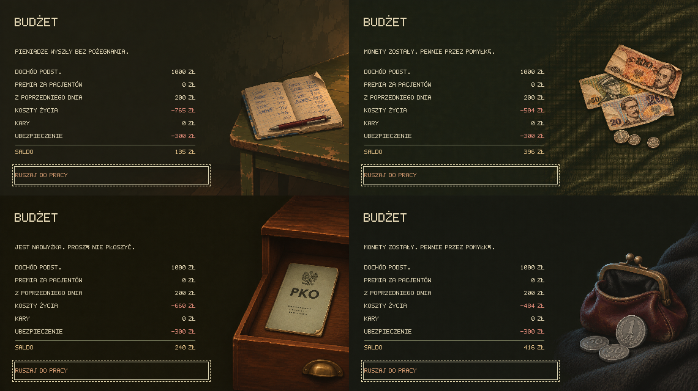
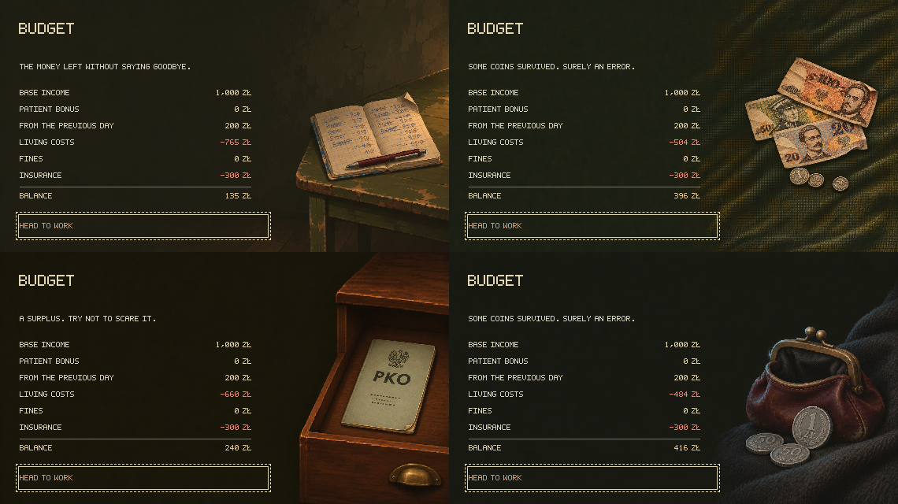

# Four household-budget subjects — 1.0.11

The author rejected the four similar notebook views from 1.0.10 and requested three or four distinct, interesting scenes, including real Polish banknotes and a period savings book. Four new compositions were generated with the built-in `image_gen` tool and the `imagegen` skill. The cash and passbook then received targeted built-in edits in response to the request for more natural placement.

## Active artwork

All runtime files are opaque 570 × 320 PNGs under `public/assets/art/`, copied to `assets/art/` by the static build.

| File | Main subject and composition |
| --- | --- |
| `budget-written-notebook.png` | A used squared notebook and red ballpoint on a chipped kitchen-table corner, viewed obliquely |
| `budget-polish-cash.png` | Worn 100, 50 and 20 zł notes casually overlapping on olive cloth, with three silver-coloured coins |
| `budget-savings-book.png` | A thin grey PKO passbook lying flat on the bottom of an open walnut drawer |
| `budget-coin-purse.png` | An open oxblood leather clasp purse on dark wool, with three loose coins, seen from a low angle |

The four subjects differ in silhouette, perspective, supporting surface and light. Each has few objects and preserves the subdued analog clinic palette. The left side stays quiet behind the ledger through x337; amounts end at x319. Localized text and focus use the existing renderer without an overlay.

Daily, weekend and pre-bankruptcy budgets use this catalog. The selection algorithm, pool size, saved RNG, finances and save v36 are unchanged. Approved domestic arrival/event scenes and all ending artwork remain unchanged. The four rejected notebook runtime images and source copies have been removed; their prompts and the 1.0.10 commit retain the production history.

## Historical research and provenance

The author specifically requested Polish banknotes. These are visual object references and do not establish the game's location. The relevant 1982 designs were inspected before generation:

- **100 zł — Ludwik Waryński:** rust-orange/brown printing, portrait on the right. [1982 object listing](https://allegro.pl/oferta/100-zl-warynski-ludwig-1982-banknot-bankowy-unc-prl-kn-od-rajmonet-o56-17682616212), [inspected photograph](https://a.allegroimg.com/original/1156bc/406ab171429186bd813dfd4425ff/100-zl-Warynski-Ludwig-1982-banknot-bankowy-UNC-PRL-KN-od-Rajmonet-O56). The existing [game-banknote record](art-progression-2026-10-26.md) provides additional museum provenance.
- **50 zł — Karol Świerczewski:** green printing, military cap and uniform. [ALEGAN's 1982 note](https://alegan.pl/pl/p/50-zl-Karol-SWIERCZEWSKI-1982-UNC/3137), [inspected photograph](https://alegan.pl/userdata/public/gfx/8628/5082A.jpg).
- **20 zł — Romuald Traugutt:** blue/lilac/cream printing, spectacles and moustache. [Supermonety's 1982 note](https://supermonety.pl/pl/p/PRL-20-zl-Romuald-Traugutt-1982-P-149a1-Z/9986), [inspected photograph](https://supermonety.pl/userdata/public/gfx/21881/PRL-20-zl-Romuald-Traugutt-1982-P-149a1-Z.jpg).
- **Coins:** the silver-grey 1 zł and 50 groszy motifs follow aluminium circulating coins, rather than modern bimetallic money. [1 zł 1983](https://numizmato.pl/news/1-zl-1983-r-jeden-zloty), [Polish Numismatic Society coin catalog](https://ptnolsztyn.fst.pl/katalog-monet/monety-prl-1949-1990/).
- **Savings book:** the familiar PKO passbook was selected for ordinary household savings. [PKO's historical account](https://stolat.pkobp.pl/65-edukacja-finansowa-w-czasach-prl/) documents their widespread use; [an archived 1980 booklet listing](https://archiwum.allegro.pl/oferta/ksiazeczka-oszczednosciowa-pko-i7457156235.html) confirms the period. The inspected [plain-cover photograph](https://a.allegroimg.com/original/1e09e1/5d58b1654d06bb47cad540287fe8), found in [this object listing collection](https://allegrolokalnie.pl/oferty/q/ksi%C4%85%C5%BCeczka%20oszcz%C4%99dno%C5%9Bciowa%20prl), supplied the thin grey paper format and understated printing. It is not claimed to be the same 1980 specimen.

External photographs were downloaded outside the repository under `/tmp/next-please-budget-references/` for visual reference only; they are not bundled or redistributed. Their original image URLs above allow the reference inputs to be recovered. No stock-photo license is claimed. Delivered images are newly generated stylized interpretations, not cropped or resized photographs. Generated-output use follows applicable OpenAI terms; this record does not grant rights in underlying currency designs or institutional marks.

Readable banknote/coin denominations and the proper acronym **PKO** are intentional historical markings requested for these objects, shared across PL/EN. Remaining microprinting is abstract; no readable account data, serial number, date or address is reproduced. Both dictionaries provide full accessible descriptions, including the banknote subjects. The images do not introduce spending mechanics or establish household relationships.

## Sources, prompts and preparation

- [Exact generation and edit prompts](art-prompts/budget-objects-2026-11-02.json), including the reference paths used by each call. Four final compositions; no API/CLI fallback.
- [Source directory](../public/assets/art/budget-objects-source/): four unchanged final generator outputs; the first cash/passbook versions and the intermediate natural cash arrangement are retained as edit inputs. Original outputs also remain in the built-in generated-images directory.
- [Preparation script](../scripts/prepare-budget-scenes.mjs): full-frame nearest-neighbor resize only, with no retouching, recoloring or drawn objects. Sharp is an offline utility, not a project dependency.
- [Gallery script](../scripts/preview-budget-scenes.mjs): assembles real browser captures at native resolution. Historical gallery filenames are refreshed with the active artwork.

The cash revision replaces the evenly spaced display with irregular overlaps, folds and close paper shadows. A final composition edit reduces the whole group to restore ledger clearance. The passbook revision removes its propped pose and thick black cover bars: the thin booklet rests on the drawer bottom with restrained printing and a close contact shadow. The initial oversized notebook draft was discarded before final generation with stricter layout constraints.

```sh
node scripts/prepare-budget-scenes.mjs /absolute/path/to/node_modules/sharp
npm run build
npm test -- tests/home-scenes.test.ts tests/weekend-scenes.test.ts tests/home.test.ts tests/weekend-budget.test.ts tests/bribe-budget.test.ts tests/release.test.ts tests/localization.test.ts tests/font.test.ts
npx playwright test tests/browser/home-scenes.spec.ts tests/browser/home.spec.ts tests/browser/weekend-scenes.spec.ts tests/browser/welcome.spec.ts --workers=2
node scripts/preview-budget-scenes.mjs /absolute/path/to/node_modules/sharp
npm run test:pages
```

## Review

Validation passed on the final edited assets: `npm run build`, 69 focused Vitest checks across eight files, 39 browser checks and both published-root Pages checks. The existing large audio-bundle advisory is unchanged. Actual PL/EN captures were inspected at native resolution for all four subjects, text contrast, Polish glyphs, negative amounts, ledger clearance and focus alignment. Existing checks cover native PNG dimensions, local artwork loading, both locales, state/RNG preservation, imported saves, daily/weekend budgets and bankruptcy.

Gallery order: notebook, Polish cash, PKO savings book, clasp purse. Each tile is an actual 570 × 320 game capture with keyboard focus.




