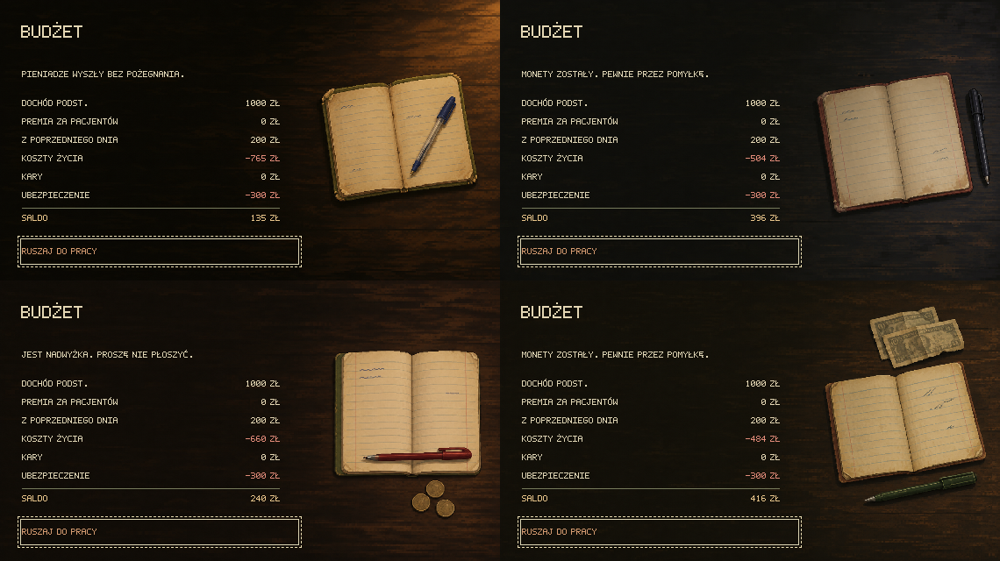
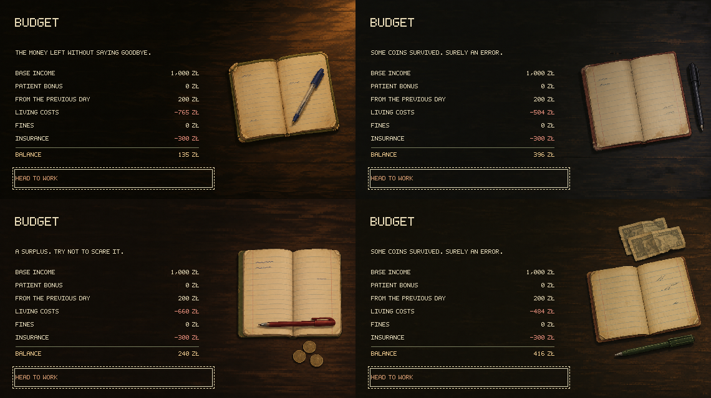

# Minimal household-budget scenes — 1.0.10

Four original illustrations generated from scratch on 2 November 2026 with the built-in `image_gen` tool and the `imagegen` skill replace the entire previous budget-background pool. The author requested fewer objects: a notebook and ballpoint pen, optionally money. Approved domestic scenes remain unchanged for arrivals and events.

## Active catalog

Each opaque RGB PNG is 570 × 320 under `public/assets/art/` and copied to `assets/art/` by the static Pages build.

| File | Composition |
| --- | --- |
| `budget-notebook-warm.png` | Open notebook and blue ballpoint pen in warm light |
| `budget-notebook-cool.png` | Open notebook and black ballpoint pen in cool evening light |
| `budget-notebook-coins.png` | Open notebook, red ballpoint pen and three dull coins |
| `budget-notebook-cash.png` | Open notebook, green ballpoint pen and two folded banknotes |

The dark wooden tabletop continues across each frame. Objects stay on the right; the left side remains quiet behind the localized ledger, including the amounts ending at x319. Paper contains faint rules and illegible strokes. The money is an original stylized prop, with no established denomination or country. No lamp, cup, radio, wallet, receipts or other decoration is added.

All daily, weekend and pre-bankruptcy ledgers use this pool. Scene selection remains a pure function of saved RNG bits and day; it does not advance randomness or change money, events or save v36. Existing financial-result captions, typography, keyboard controls and ending illustrations are preserved. The old `home-evening`, `weekend-budget` and `weekend-radio` images are now used only on domestic arrival/event cards, despite the historical kitchen filename.

The rejected `budget-lamplight`, `budget-kitchen`, `budget-sideboard` and `budget-window` runtime PNGs and their twelve source/reference images have been removed. The old mixed galleries have been rebuilt without them. Their [historical prompts](art-prompts/retired-budget-scenes-2026-11-01.json) remain as text-only production history and are not used by a preparation script.

## Sources and preparation

- [Exact final prompts](art-prompts/budget-scenes-2026-11-02.json): four separate built-in generation calls, opaque backgrounds, no reference-image inputs. The approved domestic images were visually inspected as style guidance. An initial oversized warm variant was rejected before the stricter layout prompt was used for the final generation.
- [Unmodified generator originals](../public/assets/art/budget-scenes-source/): all four final sources, copied from the built-in generated-images directory; originals also remain there.
- [Preparation recipe](../scripts/prepare-budget-scenes.mjs): full-frame nearest-neighbor resizing only. No cropping, recoloring, retouching or code-drawn objects.
- [Gallery recipe](../scripts/preview-budget-scenes.mjs): combines actual Playwright captures at native resolution without adding artwork or labels.

These are original generated project assets, not acquired stock imagery or extracted game assets. No separate third-party attribution or redistribution license applies. No API/CLI generation fallback was used. Sharp is an offline preparation utility, not a project dependency.

```sh
node scripts/prepare-budget-scenes.mjs /absolute/path/to/node_modules/sharp
npm run build
npm test -- tests/home-scenes.test.ts tests/weekend-scenes.test.ts tests/home.test.ts tests/weekend-budget.test.ts tests/bribe-budget.test.ts tests/release.test.ts tests/localization.test.ts tests/font.test.ts
npx playwright test tests/browser/home-scenes.spec.ts tests/browser/home.spec.ts tests/browser/weekend-scenes.spec.ts tests/browser/welcome.spec.ts --workers=2
node scripts/preview-budget-scenes.mjs /absolute/path/to/node_modules/sharp
node scripts/preview-home-scenes.mjs /absolute/path/to/node_modules/sharp
npm run test:pages
```

## Review

Validation passed: `npm run build`, 69 focused Vitest checks across eight files, 39 Playwright checks across home, home-scenes, weekend-scenes and welcome, and both published-root Pages checks. The build retains its existing large audio-bundle advisory. PL/EN galleries were visually inspected at native resolution for ledger clearance, Polish glyphs, negative amounts and keyboard focus. Existing suites cover all four selected PNGs, save round-trips, unchanged state and RNG, weekend summaries, bankruptcy and localized descriptions.

Gallery order: warm, cool, coins, banknotes. Each tile is a real 570 × 320 budget view with keyboard focus.




