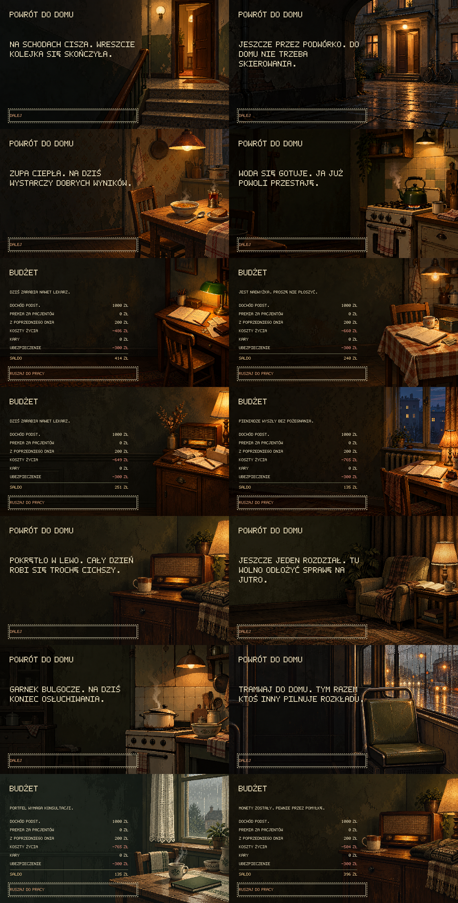
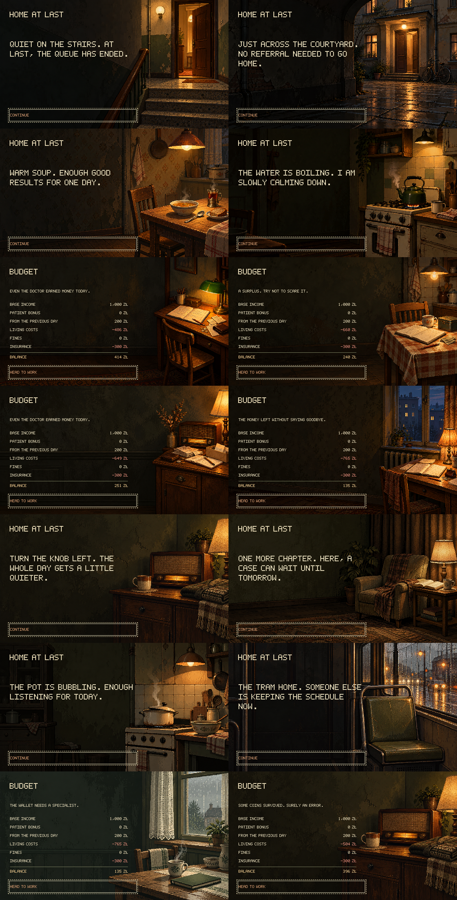

# Return-home and budget scenes — 1.0.9

Eight original illustrations were created on 1 November 2026 with the built-in `image_gen` tool and the `imagegen` skill: four for returning home and four for household accounts. The approved hallway, evening room, radio and kitchen were inspected before generation. No stock assets, extracted game art or API/CLI generation fallback were used.

## Active catalog

All runtime images are opaque 570 × 320 PNGs under `public/assets/art/`.

| New file | Role | Scene |
| --- | --- | --- |
| `home-stairwell.png` | Weekday arrival | Worn stairs and warm light through an apartment door |
| `home-courtyard.png` | Weekday arrival | Courtyard entrance at dusk, bicycle and damp paving |
| `home-supper.png` | Weekday arrival | Soup, bread and tea at the kitchen table |
| `home-kettle.png` | Weekday arrival | Steaming enamel kettle on an old stove |
| `budget-lamplight.png` | Daily/weekend budget | Notebook, receipts and wallet beneath a green lamp |
| `budget-kitchen.png` | Daily/weekend budget | Accounts on kitchen oilcloth, tea and a coin tin |
| `budget-sideboard.png` | Daily/weekend budget | Receipts and notebook beside a wooden radio |
| `budget-window.png` | Daily/weekend budget | Accounts and coin purse beside a dusk window |

Weekday arrivals also use the original `homecoming`, `weekend-budget`, `weekend-reading`, `weekend-radio` and `weekend-soup` images. These nine options are available all year. `weekend-rain-tram` is the tenth option in March–April and September–November, using the same season window as weekends. Each of the four new and five reused domestic/transit scenes has two weekday-specific comments in Polish and English under `home.arrivalSceneComments`; the hallway keeps its twelve original comments. Weekday text does not claim the doctor had no admissions that day.

The budget pool has seven options: the four new account scenes, `home-evening`, `weekend-budget` and `weekend-radio`. It applies to daily and combined weekend budgets. It excludes the selected arrival background and, when present, the weekday expense-card background, so neither is repeated by the ledger. All budgets retain their five profit, five loss and five break-even comments; a radio background does not replace those with a radio caption. Departures always use the single original `going-to-work.png` with the existing twelve comments.

Weekend arrival selection keeps its established priorities: modest meal, saved trip, first other expense, then ordinary seasonal scene. It retains its existing captions and season windows. Expense events, payments, timings, costs and ending priorities are unchanged. Bankruptcy retains its previous fixed ledger background; the hospital card remains unchanged. These are presentation changes, not new events or world facts.

## Selection and persistence

`src/scenes/home-art.ts` chooses weekday arrival artwork from saved RNG bits shifted by eight plus the day. Weekday captions use bits shifted by sixteen, separately from scene choice, so both variants remain reachable. Budget selection uses bits shifted by sixteen plus the day, after excluding preceding backgrounds. Weekend arrival selection stays in `src/scenes/weekend.ts`.

No selection advances the RNG, reads the host clock, mutates game state, adds costs or writes preferences. Language changes, repainting and importing the same settled save preserve the image and caption. Separate days may repeat an image; no cross-day appearance history is stored. Save format v36 is unchanged. Older saves adopt the current presentation catalog while keeping their recorded economic and gameplay state.

## Sources, exact prompts and preparation

- [Exact generation and revision prompts](art-prompts/home-scenes-2026-11-01.json): one initial built-in call per image, all with `transparent_background: false`.
- [Retained source directory](../public/assets/art/home-scenes-source/): eight final generator originals. The four budget files also retain `-initial.png` originals and the exact 570 × 320 `-initial-reference.png` inputs used for their composition edits.
- [Preparation recipe](../scripts/prepare-home-scenes.mjs): full-composition nearest-neighbor resizing only. No cropping, recoloring, painted repairs or replacement objects.
- [Gallery recipe](../scripts/preview-home-scenes.mjs): assembles actual browser captures at native resolution, without adding illustration or text.

The initial budget compositions placed furniture beneath the right-aligned amounts. Four additional built-in image-edit calls moved and compacted the furniture into the right third, retaining the scenes and leaving a dark wall/floor behind the ledger. The revised generator outputs are the active source files. No tint overlay was introduced. Sources retain the subdued olive/charcoal palette, hard pixel clusters, period objects and amber domestic light. No image establishes a country, city or household relationship.

These are original generated project assets; no separate acquired-asset license or attribution applies. Source images are retained unchanged, and the generator's original output files were left in place. Sharp 0.35.4 is an offline preparation utility, not a package or runtime dependency. Reproduce preparation with a locally available Sharp module:

```sh
node scripts/prepare-home-scenes.mjs /absolute/path/to/node_modules/sharp
npm run build
npx playwright test tests/browser/home-scenes.spec.ts tests/browser/home.spec.ts tests/browser/weekend-scenes.spec.ts tests/browser/welcome.spec.ts --workers=2
node scripts/preview-home-scenes.mjs /absolute/path/to/node_modules/sharp
```

## Review

Validation completed: `npm run build`, 191 focused Vitest checks across eight files, 42 Playwright checks across home, home-scenes, weekend-scenes and welcome, and two published-root Pages checks. Both final galleries were visually inspected for Polish glyphs, wrapping, focus alignment and contrast; the revised budget artwork leaves the amount column clear. The build retains its existing large audio-bundle advisory.

Focused Vitest checks cover real settled-save reachability, both captions, seasonal reuse, PL/EN line widths, native asset dimensions, unchanged state and RNG, save round-trips, distinct arrival/event/budget backgrounds, financial-result captions and the fixed departure/ending art. Playwright checks every weekday arrival and budget background against the actual loaded local PNG, localized accessible text, keyboard focus and progression, and repeated save imports. Existing home/weekend suites cover typewriter reveal, reduced motion, music, summed ledgers and bankruptcies; the welcome suite checks the new release label. Published-root checks exercise the static Pages build under its subpath.

Gallery order: four new arrivals, four new budgets, reused radio/reading/soup/tram arrivals, reused kitchen/radio budgets. Each tile is a real 570 × 320 game capture with keyboard focus.




