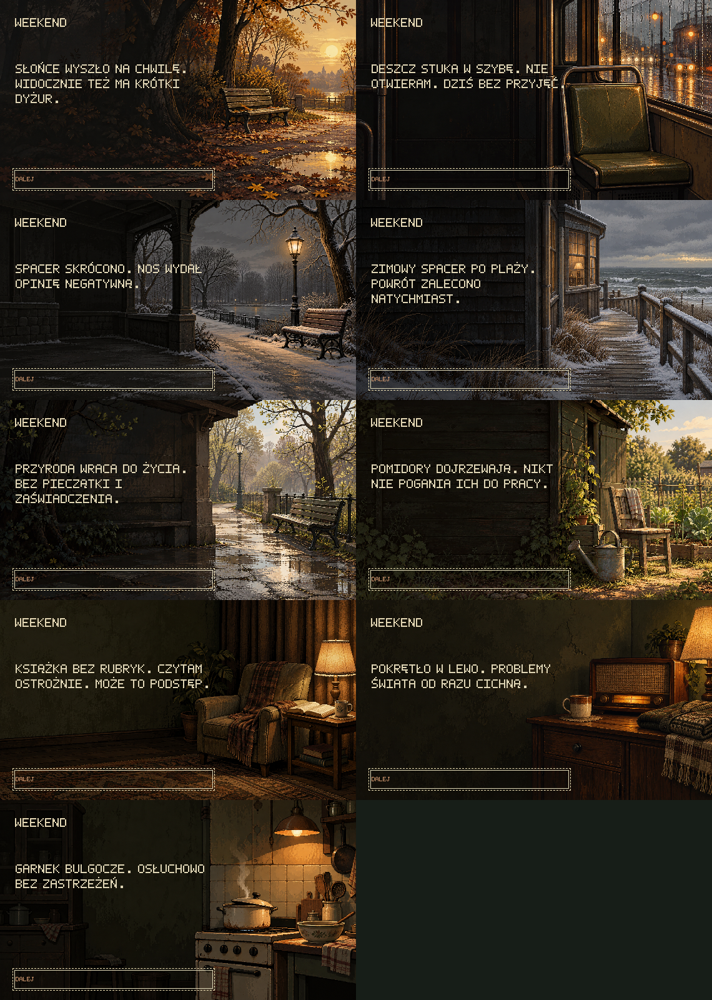
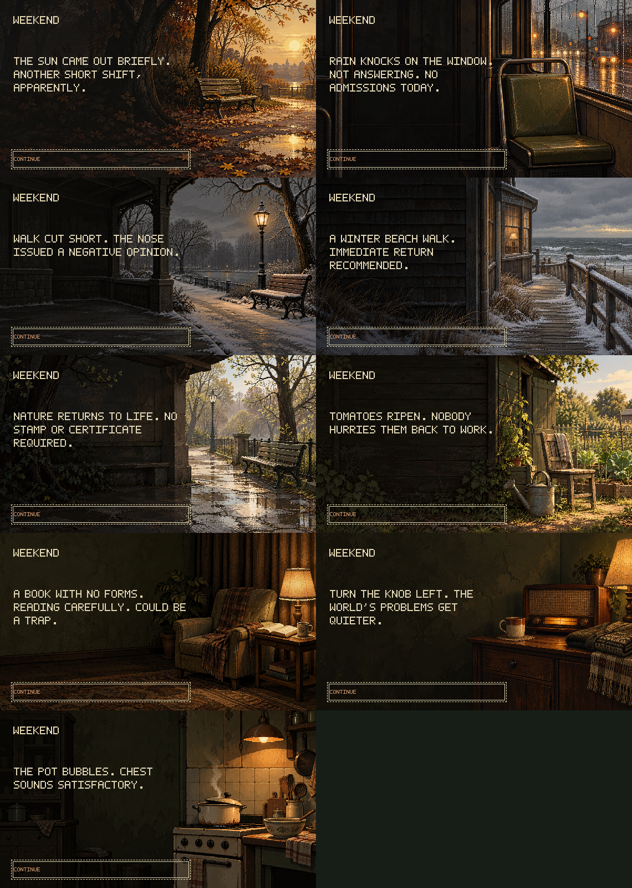

# Seasonal weekend scenes

Created on 30 October 2026 with ten separate calls to the built-in `image_gen` tool using the imagegen skill. Nine of the ten generated illustrations remain active, with eighteen new comments (two per illustration) in both Polish and English and eight revised existing weekend/event comments. At the user’s request, the similar snowy mountain variant was removed from runtime; its generated source and exact prompt remain archived. Mountain trips use the original neutral view, renamed `weekend-mountain-resort.png`; the original seaside view is now `weekend-seaside-resort.png`.

Review the actual in-game captures: [Polish gallery](weekend-scenes-pl-2026-10-30.png) and [English gallery](weekend-scenes-en-2026-10-30.png). Each tile is the full 570 × 320 viewport at native resolution, including keyboard focus. Reading order matches the catalog below.

## Catalog and Polish comments

All periods refer to the current **in-game** civil date, normally the Sunday at the end of the settled weekend. They recur each year and use neither the computer clock nor the selected language. Season windows are presentation tuning, not a weather simulation. Ordinary new scenes add no expense or gameplay action.

| Illustration | Availability | Comment 1 | Comment 2 |
| --- | --- | --- | --- |
| [Autumn park](../public/assets/art/weekend-autumn-park.png) | October 1–November 15 | Liście spadają. Ciśnienie też. Wreszcie zgodność wyników. | Słońce wyszło na chwilę. Widocznie też ma krótki dyżur. |
| [Rainy tram](../public/assets/art/weekend-rain-tram.png) | March–April, September–November | Tramwaj jedzie bez skierowania. Można się wiele nauczyć. | Deszcz stuka w szybę. Nie otwieram. Dziś bez przyjęć. |
| [Winter park](../public/assets/art/weekend-winter-park.png) | December–February | Spacer skrócono. Nos wydał opinię negatywną. | Świeże powietrze. Tak świeże, że aż szczypie. |
| [Winter seaside](../public/assets/art/weekend-winter-seaside.png) | December–February, saved seaside trip | Zimowy spacer po plaży. Powrót zalecono natychmiast. | Morze bez kolejki. Rozsądek podpowiada dlaczego. |
| [Spring park](../public/assets/art/weekend-spring-park.png) | March–May | Przyroda wraca do życia. Bez pieczątki i zaświadczenia. | Pąki się otwierają. Na szczęście nie nowa przychodnia. |
| [Summer garden](../public/assets/art/weekend-summer-garden.png) | June–August | Pomidory dojrzewają. Nikt nie pogania ich do pracy. | W ogródku też trzeba się schylać. Urlop dla pleców odwołany. |
| [Reading](../public/assets/art/weekend-reading.png) | All year | Książka bez rubryk. Czytam ostrożnie. Może to podstęp. | Bohater ma kłopoty. Na szczęście nie zna mojego adresu. |
| [Radio](../public/assets/art/weekend-radio.png) | All year | Radio mówi, ja milczę. Bardzo udana konsultacja. | Pokrętło w lewo. Problemy świata od razu cichną. |
| [Soup](../public/assets/art/weekend-soup.png) | All year | Zupa dochodzi do siebie. Dziś to mój jedyny pacjent. | Garnek bulgocze. Osłuchowo bez zastrzeżeń. |

English counterparts and the nine active new accessible illustration descriptions in both languages are authored alongside the Polish text in [`src/i18n.ts`](../src/i18n.ts), under `home.weekendComments` and `home.illustrations`. Artwork is shared across languages. The ordinary kitchen remains an additional all-year option, so the weekend arrival sequence now has thirteen distinct illustrations including the modest scene and the renamed original resort scenes.

## Revised existing comments

| Variant | Current Polish comment |
| --- | --- |
| Ordinary weekend | Plan na weekend: nic. W razie opóźnień nic zostanie na poniedziałek. |
| Modest weekend | Ziemniak, chleb i herbata. Trzy dania. Trzeba tylko jeść osobno. |
| Fur coat | Nowe futro grzeje. Rachunek wywołuje zimne poty. |
| Pharmacy | W aptece też kolejka. Tym razem stoję po niewłaściwej stronie lady. |
| Car repair | Mechanik osłuchał silnik. Rokowania dobre. Dla mechanika. |
| Home repair | Kran nie trzyma. Hydraulik też stawia diagnozę za pieniądze. |
| Mountain trip (all year) | W górach ciśnienie niższe. Wystarczyło wyjechać bez papierów. |
| Nonwinter seaside trip | Fale przychodzą bez skierowania. Wszystkie przyjęte. |

The four non-trip expense comments also appear on their existing weekday event cards. Resort trips are drawn only on rest days. Budget and departure comment pools retain their established wording. This revision does not identify a country, name a resort, specify household relationships or assign ownership of the garden.

## Selection and persistence

`src/scenes/weekend.ts` supplies the eligible ordinary images and season-specific trip image. `src/scenes/home.ts` preserves the priority of the modest living mode, then the first saved trip, then the first other expense. An ordinary weekend with no event chooses among the kitchen, three season-neutral indoor scenes and eligible outdoor scenes. At least four ordinary illustrations are always available. Trips are still the existing paid events, with their existing costs. Mountains use one neutral image all year. Seaside trips use `weekend-winter-seaside` in December–February and `weekend-seaside-resort` in March–November.

Scene selection uses the existing saved RNG shifted by eight bits plus the week index. The two new captions use bits shifted by sixteen plus the day, avoiding a fixed coupling between image and caption. Reading, repainting, changing language and reimporting the same settled state do not change selection or advance the RNG. Selection can recur across different weekends; no unseen-scene history is stored. The final settled date determines the season when a weekend crosses a month or year.

The combined Friday–Sunday budget continues to use `weekend-budget.png`, followed by `going-to-work.png`. Bankruptcy and hospital endings retain their priority. The ordinary expense probability and cost bounds are unchanged. New weekends permit at most one trip; historical settled balances, localStorage use and save version 29 remain unchanged.

### Audited trip logic

Saturday and Sunday settle separately, with at most one trip across the two days. A trip is possible only as an extra expense on a rest day, after that day's ordinary costs leave more than 2000 zł. The probability of any extra expense is `min(0.85, 0.10 + (available - 2000) / 10000)`; after a successful draw, medicine, car repair, home repair, fur coat, mountain trip and seaside trip have equal weight while a trip remains eligible. Thus each eligible trip type has one sixth of that daily probability. If Saturday already contains a mountain or seaside trip, Sunday excludes both trip kinds and chooses equally among the four ordinary expense kinds. If Saturday had no trip, either destination can still be drawn on Sunday. There is no season restriction on the trip event itself.

Every event costs an integer from 200 zł up to `min(available - reservedSundayLiving, 700 + floor((available - 2000) * 0.75))`. Saturday's Sunday living reservation is protected. The immediately preceding Saturday ledger supplies the trip limit even after save import. No new persisted flag is needed, and the limit does not carry into the next weekend. The single weekend card presents the trip; the budget includes it and all other recorded expenses. Historical saves that already settled two trips remain valid, retain both recorded costs and present their first trip. Stored event IDs (`mountain-trip`, `seaside-trip`) and the save schema are unchanged.

## Provenance and preparation

- Exact generation requests: [`art-prompts/weekend-seasonal-2026-10-30.json`](art-prompts/weekend-seasonal-2026-10-30.json), one prompt per image, all with `transparent_background: false`.
- Unmodified generated originals: [`public/assets/art/weekend-seasonal-source/`](../public/assets/art/weekend-seasonal-source/), using the ten filenames from the prompt manifest.
- Active runtime PNGs: `public/assets/art/<same filename>.png`, each 570 × 320 and opaque. The retired `weekend-winter-mountains` has `active: false` in the prompt manifest and is skipped by preparation and preview scripts.
- Preparation recipe: [`scripts/prepare-weekend-scenes.mjs`](../scripts/prepare-weekend-scenes.mjs).

The existing kitchen, modest meal and resort artwork was visually inspected for palette, composition and period detail. These were new generation requests without attached image inputs. All ten returned sources were copied into the repository, leaving the tool's original files in place. No stock imagery, extracted game art, CLI/API generation fallback or third-party graphical assets were used. The images are original generated project assets; no separate acquired-asset license or attribution applies. ImageMagick is an offline utility, not a runtime or package dependency.

Recreate the runtime files with ImageMagick 6.9.11-60 (`convert`) available:

```sh
node scripts/prepare-weekend-scenes.mjs
```

The recipe uses full-composition point/nearest-neighbor resizing to 570 × 320 and strips metadata. It does not crop, paint, recolor, replace objects or add text. Rendering composites the local PNG and existing localized text/focus only. The illustrations retain early-1980s ordinary objects, charcoal/olive shadows, restrained warm light and a quiet left text area. No visible country, city, real landmark or readable label is introduced.

## Verification and review captures

`npm run build` passed. The focused Vitest run passed **182 tests** across home presentation, weekend scene eligibility, weekend budget/save behavior, bribe budgets, economy rules and save validation. It checks the November 15/16 cutoff, December 1, the year boundary, February 29/March 1, two complete annual cycles, all eighteen active new captions in both languages, native line widths, local PNG dimensions, save round-trips, unchanged state, expense priority, the modest fallback and the one-trip limit across Saturday imports and month/year boundaries, and compatibility with already settled historical double-trip weekends.

The two relevant Playwright suites passed **20 tests**, including all nine active new scenes and both renamed original resort scenes in Polish and English, pixel comparison against the selected local asset, keyboard focus/actions, reduced motion, repeated save imports, the combined budget and departure. Existing home tests also cover typewriter reveal, music, bankruptcy and expenses. Both complete galleries were visually inspected for Polish glyphs, wrapping, contrast and composition.

Recreate the galleries from actual browser captures:

```sh
npm run build
npx playwright test tests/browser/home.spec.ts tests/browser/weekend-scenes.spec.ts --workers=2
node scripts/preview-weekend-scenes.mjs
```

The preview recipe uses point resizing and a two-column, five-row montage; it adds no illustration or text. All source images and prompts are retained independently of the preview captures.




