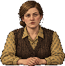
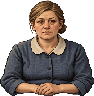
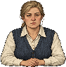
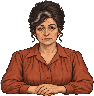

# Tożsamości pacjentów według portretu

Każda ze 188 twarzy ma pięć gotowych tożsamości: imię i nazwisko, stały zawód oraz datę urodzenia. Wiek w tabeli dotyczy 3 listopada 1983 r.; różni się najwyżej o trzy lata od wieku przyjętego przy tworzeniu ilustracji. Dobór zawodów uwzględnia ubiór, stylizację i wiek fikcyjnej postaci.

Nowa kolejka wybiera jedną tożsamość dla każdej twarzy. Badania mogą mieć różne wyniki, ale nie zmieniają nazwiska, zawodu ani daty urodzenia. Między dniami pierwszeństwo mają twarze jeszcze niewidziane, a potem te przyjęte najdawniej. Historia obejmuje rzeczywiste przyjęcia, także wizyty przerwane zamknięciem przychodni; zapis gry zachowuje tę kolejność. Ta sama twarz nie pojawia się drugi raz w nowej kolejce tego dnia; powrót po badaniu dodatkowym jest kontynuacją tej samej wizyty. Dawne kolejki i dokumenty z importowanych zapisów zachowują identyfikatory przypadków, zawody i wyniki; nowy dobór obowiązuje od następnego układania kolejki.

Audyt obsady z 1 listopada 2026 zastępuje wcześniejszą korektę nazw z 26 października. Portrety 11, 23, 24, 26, 29, 34, 38, 40, 47, 66, 139, 142, 153, 165, 169, 170, 172, 176 i 181 otrzymują po pięć zwyczajnych polskich imion i nazwisk oraz stałe odpowiedniki angielskie. Nazwy są zgodne z płcią i wiekiem postaci; portret 11 ma teraz kobiece imiona również w dawnych przypadkach. Poprawione etykiety obowiązują też na archiwalnych dokumentach po imporcie. Identyfikatory, daty urodzenia, zawody i dane medyczne pozostają stabilne. [Lista zmian i nowe portrety](art-patients-audit-2026-11-01.md) dokumentują kierunek artystyczny, bez ustalania kraju akcji.

Dane: [profile](../src/core/patient-identities.ts), [katalog przypadków](../src/core/patients.ts), [nazwiska i zawody PL/EN](../src/i18n.ts). Wszystkie portrety są lokalnymi ilustracjami gry. Portrety 76–85 przedstawiają milicjantów, a 86–90 pilotów: każda z pięciu tożsamości zachowuje zawód zgodny z mundurem. Portrety 91, 95 i 99 to hutnicy, a 93 i 97 górnicy. Ich źródła i pochodzenie opisuje [kierunek artystyczny](art-direction.md).

Tabela poniżej podaje polskie nazwy. Wersja EN korzysta ze stałych odpowiedników opisanych w [zasadach lokalizacji i słowniku](localization.md), np. Irena Wolska → Irene Wells. Dotyczy to również dawnych przypadków i dokumentów; język wybiera wyłącznie etykietę tej samej tożsamości.

| Portret | Pięć tożsamości — imię i nazwisko, zawód, wiek |
| --- | --- |
|  patient-0 | Irena Górska — Archiwistka, 39 lat Ewa Wierna — Księgowa, 41 lat Teresa Kępa — Referentka, 42 lata Anna Wolska — Bibliotekarka, 44 lata Maria Lipiec — Korektorka, 40 lat |
|  patient-1 | Leon Wroński — Mechanik, 43 lata Roman Błasik — Operator suwnicy, 45 lat Stefan Witek — Elektryk, 46 lat Jan Bukowski — Hutnik, 48 lat Henryk Cegła — Brygadzista, 44 lata |
|  patient-2 | Marta Jodła — Bibliotekarka, 56 lat Zofia Dębska — Nauczycielka, 58 lat Halina Bielec — Archiwistka, 59 lat Jadwiga Młyn — Korektorka, 61 lat Barbara Kłos — Księgowa, 57 lat |
|  patient-01 | Anna Brzoza — Referentka, 24 lata Ewa Malina — Recepcjonistka, 26 lat Olga Zielna — Krawcowa, 27 lat Lidia Kurek — Bibliotekarka, 29 lat Iwona Łącka — Korektorka, 25 lat |
|  patient-02 | Roman Łęcki — Inżynier, 51 lat Henryk Bork — Brygadzista, 53 lata Stefan Cedro — Kierownik, 54 lata Witold Jurek — Technik, 56 lat Jan Struga — Kontroler jakości, 52 lata |
|  patient-03 | Ewa Mrozek — Księgowa, 39 lat Teresa Staw — Archiwistka, 41 lat Irena Dąbek — Referentka, 42 lata Maria Witek — Korektorka, 44 lata Alicja Grab — Bibliotekarka, 40 lat |
|  patient-04 | Paweł Borek — Mechanik, 28 lat Marek Gruda — Elektryk, 30 lat Piotr Gacek — Torowy, 31 lat Adam Młyn — Spawacz, 33 lata Jerzy Orlik — Stolarz, 29 lat |
|  patient-05 | Zofia Gaj — Bibliotekarka, 57 lat Jadwiga Kurek — Nauczycielka, 59 lat Maria Wrona — Archiwistka, 60 lat Halina Sikora — Krawcowa, 62 lata Barbara Bór — Korektorka, 58 lat |
|  patient-06 | Stefan Polak — Brygadzista, 42 lata Henryk Szpak — Inżynier, 44 lata Roman Biela — Kontroler jakości, 45 lat Jan Klon — Kierownik, 47 lat Witold Las — Technik, 43 lata |
|  patient-07 | Lidia Łęcka — Krawcowa, 31 lat Iwona Czapla — Introligatorka, 33 lata Ewa Łan — Korektorka, 34 lata Anna Wrzos — Referentka, 36 lat Alicja Cicha — Bibliotekarka, 32 lata |
|  patient-08 | Edward Jodła — Profesor, 59 lat Wiktor Chmiel — Redaktor, 61 lat Jerzy Kurek — Bibliotekarz, 62 lata Henryk Góral — Inżynier, 64 lata Stanisław Bór — Nauczyciel, 60 lat |
|  patient-09 | Halina Mazur — Księgowa, 45 lat Teresa Wolska — Referentka, 47 lat Irena Łącka — Recepcjonistka, 48 lat Zofia Biela — Nauczycielka, 50 lat Barbara Rak — Archiwistka, 46 lat |
|  patient-10 | Adam Ruda — Mechanik, 22 lata Paweł Kania — Elektryk, 24 lata Marek Kret — Spawacz, 25 lat Piotr Żyto — Tokarz, 27 lat Tomasz Biela — Stolarz, 23 lata |
|  patient-11 | Halina Kubiak — Nauczycielka, 36 lat Teresa Jaworska — Bibliotekarka, 38 lat Irena Malicka — Referentka, 39 lat Zofia Sadowska — Korektorka, 41 lat Barbara Rogala — Krawcowa, 37 lat |
|  patient-12 | Jan Łuczak — Inżynier, 47 lat Roman Jawor — Brygadzista, 49 lat Henryk Wilk — Technik, 50 lat Stefan Brzeg — Kontroler jakości, 52 lata Jerzy Głaz — Kierownik, 48 lat |
|  patient-13 | Barbara Kania — Księgowa, 53 lata Halina Ruda — Profesorka, 55 lat Maria Cedro — Bibliotekarka, 56 lat Jadwiga Wrona — Nauczycielka, 58 lat Irena Gaj — Korektorka, 54 lata |
|  patient-14 | Marek Pióro — Pomoc geodety, 34 lata Paweł Zimny — Elektryk, 36 lat Tomasz Kłos — Technik, 37 lat Adam Ptak — Ogrodnik, 39 lat Piotr Wilga — Stolarz, 35 lat |
|  patient-15 | Olga Wilga — Referentka, 20 lat Nina Wolska — Laborantka, 22 lata Ewa Rój — Bibliotekarka, 23 lata Anna Kłos — Korektorka, 25 lat Kinga Dąb — Recepcjonistka, 21 lat |
|  patient-16 | Wiktor Wierny — Profesor, 55 lat Jerzy Bielski — Inżynier, 57 lat Edward Sitar — Redaktor, 58 lat Henryk Duda — Nauczyciel, 60 lat Stefan Jaśko — Bibliotekarz, 56 lat |
|  patient-17 | Alicja Bork — Kierowniczka, 43 lata Irena Rosa — Księgowa, 45 lat Teresa Żur — Referentka, 46 lat Ewa Chmiel — Redaktorka, 48 lat Maria Kret — Nauczycielka, 44 lata |
|  patient-18 | Piotr Jaskier — Tokarz, 26 lat Paweł Kłosik — Stolarz, 28 lat Marek Sowa — Mechanik, 29 lat Adam Migała — Zecer, 31 lat Tomasz Bąk — Zegarmistrz, 27 lat |
|  patient-19 | Jadwiga Jodła — Bibliotekarka, 61 lat Zofia Cicha — Archiwistka, 63 lata Maria Kępa — Nauczycielka, 64 lata Halina Bór — Korektorka, 66 lat Barbara Wrona — Krawcowa, 62 lata |
|  patient-20 | Henryk Żuk — Kierownik, 38 lat Jerzy Łącki — Inżynier, 40 lat Roman Wrona — Architekt, 41 lat Jan Wierny — Księgowy, 43 lata Stefan Jodła — Redaktor, 39 lat |
|  patient-21 | Danuta Gaj — Laborantka, 29 lat Ewa Struga — Technik, 31 lat Anna Wierna — Kontrolerka jakości, 32 lata Lidia Ruda — Kreślarka, 34 lata Iwona Klon — Referentka, 30 lat |
|  patient-22 | Jerzy Staw — Inżynier, 50 lat Henryk Cichy — Księgowy, 52 lata Roman Kłosik — Archiwista, 53 lata Stefan Wrona — Redaktor, 55 lat Witold Rzepka — Bibliotekarz, 51 lat |
|  patient-23 | Danuta Walczak — Laborantka, 41 lat Ewa Zawada — Chemiczka, 43 lata Anna Michalak — Technik, 44 lata Lidia Sobczak — Kontrolerka jakości, 46 lat Iwona Rataj — Nauczycielka, 42 lata |
|  patient-24 | Andrzej Kubiak — Pomoc geodety, 32 lata Marek Sadowski — Technik, 34 lata Paweł Ratajczak — Elektryk, 35 lat Roman Marciniak — Kontroler jakości, 37 lat Wiesław Sobota — Ogrodnik, 33 lata |
|  patient-25 | Maria Jaśko — Korektorka, 48 lat Halina Śliwa — Redaktorka, 50 lat Barbara Mrozek — Bibliotekarka, 51 lat Irena Biela — Księgowa, 53 lata Zofia Pióro — Nauczycielka, 49 lat |
|  patient-26 | Janusz Adamczyk — Mechanik, 30 lat Zbigniew Czerwiński — Tokarz, 32 lata Ryszard Pawlak — Elektryk, 33 lata Bogdan Woźniak — Wózkowy, 35 lat Krzysztof Sobczak — Hutnik, 31 lat |
|  patient-27 | Helena Sowa — Nauczycielka, 44 lata Maria Rybak — Księgowa, 46 lat Irena Żyto — Bibliotekarka, 47 lat Ewa Róża — Krawcowa, 49 lat Teresa Czapla — Referentka, 45 lat |
|  patient-28 | Franciszek Gaj — Profesor, 58 lat Edward Leśny — Inżynier, 60 lat Wiktor Rybak — Redaktor, 61 lat Jerzy Górski — Bibliotekarz, 63 lata Henryk Ptak — Archiwista, 59 lat |
|  patient-29 | Ewa Michalska — Laborantka, 25 lat Anna Janicka — Korektorka, 27 lat Teresa Walczak — Referentka, 28 lat Iwona Pawlak — Bibliotekarka, 30 lat Lidia Wysocka — Krawcowa, 26 lat |
|  patient-30 | Bogdan Rój — Technik, 37 lat Marek Wolski — Inżynier, 39 lat Paweł Staw — Kreślarz, 40 lat Adam Mrozek — Laborant, 42 lata Tomasz Ruda — Kontroler jakości, 38 lat |
|  patient-31 | Łucja Dąbek — Krawcowa, 52 lata Halina Wicher — Tkaczka, 54 lata Maria Sitar — Kontrolerka jakości, 55 lat Barbara Żak — Introligatorka, 57 lat Irena Wilga — Praczka, 53 lata |
|  patient-32 | Emil Ruda — Tokarz, 21 lat Paweł Czajka — Mechanik, 23 lata Marek Młyn — Zecer, 24 lata Piotr Klon — Introligator, 26 lat Adam Łęcki — Technik, 22 lata |
|  patient-33 | Krystyna Las — Bibliotekarka, 62 lata Zofia Kret — Archiwistka, 64 lata Jadwiga Łan — Nauczycielka, 65 lat Halina Duda — Korektorka, 67 lat Maria Głaz — Sprzątaczka, 63 lata |
|  patient-34 | Józef Kaczmarek — Brygadzista, 46 lat Kazimierz Wieczorek — Mechanik, 48 lat Stanisław Tomczak — Magazynier, 49 lat Marian Kubiak — Palacz, 51 lat Henryk Pawlak — Woźny, 47 lat |
|  patient-35 | Iwona Żyto — Referentka, 33 lata Anna Cicha — Księgowa, 35 lat Ewa Górka — Recepcjonistka, 36 lat Lidia Rzepka — Nauczycielka, 38 lat Teresa Biela — Krawcowa, 34 lata |
|  patient-36 | Zbigniew Klon — Profesor, 54 lata Wiktor Mazur — Redaktor, 56 lat Edward Wolski — Inżynier, 57 lat Jerzy Chmiel — Nauczyciel, 59 lat Henryk Lisek — Bibliotekarz, 55 lat |
|  patient-37 | Renata Kłos — Referentka, 27 lat Anna Gacek — Księgowa, 29 lat Olga Jodła — Laborantka, 30 lat Ewa Kurek — Bibliotekarka, 32 lata Lidia Szpak — Korektorka, 28 lat |
|  patient-38 | Jerzy Malicki — Architekt, 40 lat Wiktor Jaworski — Kreślarz, 42 lata Tadeusz Zawada — Inżynier, 43 lata Roman Sobota — Technik, 45 lat Andrzej Michalak — Pomoc geodety, 41 lat |
|  patient-39 | Grażyna Witek — Księgowa, 56 lat Maria Łan — Bibliotekarka, 58 lat Irena Duda — Nauczycielka, 59 lat Halina Jaskier — Archiwistka, 61 lat Barbara Śliwa — Korektorka, 57 lat |
|  patient-40 | Piotr Marciniak — Mechanik, 23 lata Marek Janicki — Spawacz, 25 lat Paweł Czerwiński — Wózkowy, 26 lat Jacek Kaczmarek — Tragarz, 28 lat Tomasz Woźniak — Torowy, 24 lata |
|  patient-41 | Urszula Kłos — Księgowa, 49 lat Teresa Jodła — Bibliotekarka, 51 lat Maria Bork — Profesorka, 52 lata Ewa Sitar — Archiwistka, 54 lata Irena Rzepka — Korektorka, 50 lat |
|  patient-42 | Dariusz Biela — Technik, 35 lat Marek Wydra — Elektryk, 37 lat Paweł Gaj — Kontroler jakości, 38 lat Adam Żur — Mechanik, 40 lat Tomasz Rosa — Pomoc geodety, 36 lat |
|  patient-43 | Celina Wilk — Bibliotekarka, 60 lat Jadwiga Gaj — Archiwistka, 62 lata Zofia Sitar — Korektorka, 63 lata Halina Kępa — Nauczycielka, 65 lat Maria Gacek — Księgowa, 61 lat |
|  patient-44 | Andrzej Buk — Brygadzista, 42 lata Roman Rzepka — Mechanik, 44 lata Henryk Sitko — Kontroler jakości, 45 lat Jan Dąbek — Inżynier, 47 lat Stefan Głaz — Nastawniczy, 43 lata |
|  patient-45 | Monika Gaj — Krawcowa, 28 lat Anna Kret — Referentka, 30 lat Ewa Czajka — Księgowa, 31 lat Iwona Struga — Laborantka, 33 lata Lidia Malina — Bibliotekarka, 29 lat |
|  patient-46 | Kazimierz Łan — Inżynier, 53 lata Edward Bork — Profesor, 55 lat Wiktor Kłos — Redaktor, 56 lat Jerzy Wydra — Bibliotekarz, 58 lat Henryk Brzeg — Nauczyciel, 54 lata |
|  patient-47 | Teresa Kaczmarek — Referentka, 38 lat Barbara Tomczak — Nauczycielka, 40 lat Irena Adamczyk — Księgowa, 41 lat Halina Wieczorek — Bibliotekarka, 43 lata Danuta Rogala — Laborantka, 39 lat |
|  patient-48 | Leszek Ruda — Kierowca, 31 lat Marek Głaz — Listonosz, 33 lata Paweł Kurek — Pomoc geodety, 34 lata Adam Żuk — Technik, 36 lat Piotr Sitko — Magazynier, 32 lata |
|  patient-49 | Bożena Sowa — Księgowa, 45 lat Irena Staw — Referentka, 47 lat Maria Polna — Nauczycielka, 48 lat Halina Klon — Bibliotekarka, 50 lat Teresa Ptak — Korektorka, 46 lat |
|  patient-50 | Ryszard Dąbek — Profesor, 57 lat Edward Wrona — Inżynier, 59 lat Wiktor Kret — Redaktor, 60 lat Jerzy Rosa — Bibliotekarz, 62 lata Henryk Kłos — Nauczyciel, 58 lat |
|  patient-51 | Wanda Biela — Referentka, 26 lat Anna Cedro — Bibliotekarka, 28 lat Ewa Żur — Korektorka, 29 lat Lidia Wilga — Recepcjonistka, 31 lat Iwona Kurek — Laborantka, 27 lat |
|  patient-52 | Sylwester Buk — Kierownik, 41 lat Roman Struga — Inżynier, 43 lata Henryk Wicher — Księgowy, 44 lata Jan Gacek — Brygadzista, 46 lat Stefan Bór — Redaktor, 42 lata |
|  patient-53 | Regina Wrona — Bibliotekarka, 55 lat Halina Ptak — Archiwistka, 57 lat Maria Wilk — Księgowa, 58 lat Irena Kret — Nauczycielka, 60 lat Zofia Duda — Korektorka, 56 lat |
|  patient-54 | Artur Jawor — Mechanik, 22 lata Paweł Rój — Tokarz, 24 lata Marek Żyto — Spawacz, 25 lat Adam Chmiel — Elektryk, 27 lat Piotr Ruda — Tragarz, 23 lata |
|  patient-55 | Joanna Sitar — Krawcowa, 34 lata Ewa Żyto — Referentka, 36 lat Anna Rosa — Bibliotekarka, 37 lat Iwona Kłos — Nauczycielka, 39 lat Lidia Biela — Księgowa, 35 lat |
|  patient-56 | Marian Kępa — Profesor, 60 lat Edward Ptak — Redaktor, 62 lata Wiktor Duda — Inżynier, 63 lata Jerzy Sitar — Bibliotekarz, 65 lat Henryk Jodła — Nauczyciel, 61 lat |
|  patient-57 | Alina Wolska — Księgowa, 47 lat Teresa Mrozek — Referentka, 49 lat Maria Żur — Recepcjonistka, 50 lat Irena Sowa — Nauczycielka, 52 lata Halina Wydra — Bibliotekarka, 48 lat |
|  patient-58 | Rafał Wrona — Technik, 29 lat Marek Duda — Elektryk, 31 lat Paweł Kret — Mechanik, 32 lata Adam Żyto — Kontroler jakości, 34 lata Piotr Wolski — Pomoc geodety, 30 lat |
|  patient-59 | Lucyna Gaj — Księgowa, 52 lata Maria Struga — Bibliotekarka, 54 lata Irena Kurek — Archiwistka, 55 lat Halina Brzeg — Nauczycielka, 57 lat Barbara Staw — Korektorka, 53 lata |
|  patient-60 | Hubert Bork — Architekt, 38 lat Marek Łan — Inżynier, 40 lat Paweł Głaz — Redaktor, 41 lat Adam Sitar — Kreślarz, 43 lata Tomasz Kępa — Nauczyciel, 39 lat |
|  patient-61 | Kinga Wilk — Księgowa, 20 lat Olga Ruda — Nauczycielka, 22 lata Anna Dąbek — Bibliotekarka, 23 lata Ewa Jodła — Referentka, 25 lat Nina Gaj — Chemiczka, 21 lat |
|  patient-62 | Tadeusz Cichy — Inżynier, 57 lat Edward Ruda — Profesor, 59 lat Wiktor Buk — Redaktor, 60 lat Jerzy Biela — Archiwista, 62 lata Henryk Gacek — Bibliotekarz, 58 lat |
|  patient-63 | Genowefa Staw — Księgowa, 44 lata Maria Wierna — Nauczycielka, 46 lat Irena Ptak — Bibliotekarka, 47 lat Halina Wrona — Referentka, 49 lat Zofia Żak — Korektorka, 45 lat |
|  patient-64 | Łukasz Żur — Stolarz, 32 lata Marek Sitar — Mechanik, 34 lata Paweł Biela — Tokarz, 35 lat Adam Gaj — Elektryk, 37 lat Piotr Rzepka — Piekarz, 33 lata |
|  patient-65 | Janina Głaz — Bibliotekarka, 62 lata Jadwiga Rosa — Archiwistka, 64 lata Zofia Kłos — Korektorka, 65 lat Maria Cicha — Nauczycielka, 67 lat Halina Leśna — Księgowa, 63 lata |
|  patient-66 | Michał Malicki — Laborant, 25 lat Piotr Sobota — Technik, 27 lat Tomasz Rataj — Kreślarz, 28 lat Jacek Walczak — Referent, 30 lat Marek Zawada — Zecer, 26 lat |
|  patient-67 | Sabina Kępa — Kucharka, 49 lat Teresa Wrona — Piekarka, 51 lat Maria Szpak — Krawcowa, 52 lata Irena Klon — Tkaczka, 54 lata Halina Gacek — Praczka, 50 lat |
|  patient-68 | Bartosz Łan — Technik, 36 lat Marek Ptak — Kreślarz, 38 lat Paweł Rosa — Pomoc geodety, 39 lat Adam Wicher — Kontroler jakości, 41 lat Tomasz Cedro — Elektryk, 37 lat |
|  patient-69 | Aniela Witek — Bibliotekarka, 58 lat Zofia Struga — Korektorka, 60 lat Jadwiga Żur — Księgowa, 61 lat Maria Duda — Archiwistka, 63 lata Halina Rybak — Nauczycielka, 59 lat |
|  patient-70 | Józef Gaj — Brygadzista, 43 lata Roman Dąbek — Inżynier, 45 lat Henryk Cedro — Nastawniczy, 46 lat Jan Rzepka — Mechanik, 48 lat Stefan Wolski — Kierownik, 44 lata |
|  patient-71 | Dorota Wrona — Laborantka, 27 lat Anna Pióro — Referentka, 29 lat Ewa Brzeg — Bibliotekarka, 30 lat Iwona Gacek — Korektorka, 32 lata Lidia Kłos — Krawcowa, 28 lat |
|  patient-72 | Ignacy Wolski — Profesor, 53 lata Edward Gaj — Redaktor, 55 lat Wiktor Biela — Inżynier, 56 lat Jerzy Dąbek — Nauczyciel, 58 lat Henryk Śliwa — Bibliotekarz, 54 lata |
|  patient-73 | Agata Staw — Nauczycielka, 40 lat Teresa Klon — Krawcowa, 42 lata Maria Malina — Referentka, 43 lata Irena Cicha — Kontrolerka jakości, 45 lat Halina Żyto — Księgowa, 41 lat |
|  patient-74 | Daniel Buk — Mechanik, 23 lata Paweł Żyto — Elektryk, 25 lat Marek Gacek — Tokarz, 26 lat Adam Wrona — Spawacz, 28 lat Piotr Cegła — Tragarz, 24 lata |
|  patient-75 | Gabriela Łan — Nauczycielka, 46 lat Teresa Wilga — Księgowa, 48 lat Maria Rzepka — Referentka, 49 lat Irena Głaz — Bibliotekarka, 51 lat Halina Czapla — Krawcowa, 47 lat |
|  patient-76 | Wiesław Żmuda — Milicjant, 23 lata Roman Świerk — Milicjant, 25 lat Stefan Kula — Milicjant, 26 lat Marek Bujak — Milicjant, 28 lat Jan Węgrzyn — Milicjant, 24 lata |
|  patient-77 | Bogusław Cisek — Milicjant, 30 lat Piotr Stach — Milicjant, 32 lata Adam Błach — Milicjant, 33 lata Jerzy Kos — Milicjant, 35 lat Paweł Górecki — Milicjant, 31 lat |
|  patient-78 | Czesław Pawlik — Milicjant, 37 lat Henryk Buda — Milicjant, 39 lat Witold Łoza — Milicjant, 40 lat Leon Bryła — Milicjant, 42 lata Tomasz Kłosowski — Milicjant, 38 lat |
|  patient-79 | Mieczysław Zięba — Milicjant, 44 lata Stanisław Gołąb — Milicjant, 46 lat Edward Szela — Milicjant, 47 lat Wiktor Jurga — Milicjant, 49 lat Józef Kuc — Milicjant, 45 lat |
|  patient-80 | Władysław Kocioł — Milicjant, 51 lat Tadeusz Wąsik — Milicjant, 53 lata Franciszek Wójcik — Milicjant, 54 lata Ignacy Cieśla — Milicjant, 56 lat Marian Żmij — Milicjant, 52 lata |
|  patient-81 | Grzegorz Jastrząb — Milicjant, 27 lat Artur Wyrwa — Milicjant, 29 lat Rafał Witek — Milicjant, 30 lat Jacek Zając — Milicjant, 32 lata Bartosz Wąski — Milicjant, 28 lat |
|  patient-82 | Sławomir Klimek — Milicjant, 34 lata Andrzej Szulc — Milicjant, 36 lat Dariusz Mazur — Milicjant, 37 lat Leszek Jagła — Milicjant, 39 lat Krzysztof Suchy — Milicjant, 35 lat |
|  patient-83 | Zdzisław Gąsior — Milicjant, 41 lat Kazimierz Moskal — Milicjant, 43 lata Jerzy Troć — Milicjant, 44 lata Roman Węgiel — Milicjant, 46 lat Bogdan Łuk — Milicjant, 42 lata |
|  patient-84 | Mirosław Janik — Milicjant, 48 lat Henryk Płatek — Milicjant, 50 lat Jan Ścigała — Milicjant, 51 lat Witold Rataj — Milicjant, 53 lata Edward Kozioł — Milicjant, 49 lat |
|  patient-85 | Bronisław Wójcik — Milicjant, 56 lat Stanisław Rybka — Milicjant, 58 lat Tadeusz Krupa — Milicjant, 59 lat Władysław Serafin — Milicjant, 61 lat Franciszek Kłosik — Milicjant, 57 lat |
|  patient-86 | Michał Wysocki — Pilot, 26 lat Paweł Skrzydło — Pilot, 28 lat Łukasz Chmura — Pilot, 29 lat Tomasz Żagle — Pilot, 31 lat Artur Słota — Pilot, 27 lat |
|  patient-87 | Robert Cieślik — Pilot, 33 lata Piotr Wietrzny — Pilot, 35 lat Marek Skowronek — Pilot, 36 lat Adam Lotny — Pilot, 38 lat Rafał Szydło — Pilot, 34 lata |
|  patient-88 | Wojciech Balicki — Pilot, 40 lat Andrzej Woźniak — Pilot, 42 lata Jacek Rudzki — Pilot, 43 lata Grzegorz Szpak — Pilot, 45 lat Sławomir Nurek — Pilot, 41 lat |
|  patient-89 | Stanisław Żarski — Pilot, 47 lat Roman Mirski — Pilot, 49 lat Jerzy Karski — Pilot, 50 lat Henryk Dębiec — Pilot, 52 lata Witold Kosma — Pilot, 48 lat |
|  patient-90 | Kazimierz Bystroń — Pilot, 54 lata Edward Rudnik — Pilot, 56 lat Władysław Wierzbicki — Pilot, 57 lat Tadeusz Łukasz — Pilot, 59 lat Marian Płonka — Pilot, 55 lat |
|  patient-91 | Wacław Żelazny — Hutnik, 29 lat Marek Płomień — Hutnik, 31 lat Paweł Kocioł — Hutnik, 32 lata Adam Grot — Hutnik, 34 lata Tomasz Kurek — Hutnik, 30 lat |
|  patient-92 | Natalia Błach — Referentka, 25 lat Anna Żelazna — Księgowa, 27 lat Ewa Płonka — Recepcjonistka, 28 lat Iwona Mirska — Bibliotekarka, 30 lat Lidia Karska — Laborantka, 26 lat |
|  patient-93 | Brunon Węglarz — Górnik, 42 lata Henryk Szyb — Górnik, 44 lata Roman Bednarz — Górnik, 45 lat Jan Pył — Górnik, 47 lat Stefan Kopa — Górnik, 43 lata |
|  patient-94 | Elżbieta Wąsik — Nauczycielka, 36 lat Teresa Cisek — Bibliotekarka, 38 lat Maria Woźniak — Referentka, 39 lat Irena Pawlik — Korektorka, 41 lat Halina Żmuda — Księgowa, 37 lat |
|  patient-95 | Alojzy Szlaka — Hutnik, 55 lat Wiktor Żelazny — Hutnik, 57 lat Edward Grot — Hutnik, 58 lat Jerzy Ogień — Hutnik, 60 lat Franciszek Płomień — Hutnik, 56 lat |
|  patient-96 | Bogumiła Bednarz — Księgowa, 44 lata Halina Węglarz — Referentka, 46 lat Zofia Szyb — Recepcjonistka, 47 lat Maria Kopa — Nauczycielka, 49 lat Jadwiga Pył — Bibliotekarka, 45 lat |
|  patient-97 | Maksymilian Rąb — Górnik, 32 lata Paweł Pokład — Górnik, 34 lata Marek Filar — Górnik, 35 lat Adam Sztolnia — Górnik, 37 lat Piotr Węglik — Górnik, 33 lata |
|  patient-98 | Stanisława Janik — Krawcowa, 50 lat Irena Kuc — Tkaczka, 52 lata Maria Bujak — Kontrolerka jakości, 53 lata Halina Kos — Introligatorka, 55 lat Zofia Troć — Praczka, 51 lat |
|  patient-99 | Bolesław Płomień — Hutnik, 59 lat Tadeusz Żelazny — Hutnik, 61 lat Edward Kocioł — Hutnik, 62 lata Jerzy Szlaka — Hutnik, 64 lata Henryk Ogień — Hutnik, 60 lat |
|  patient-100 | Renata Łoza — Laborantka, 39 lat Ewa Rataj — Chemiczka, 41 lat Anna Bryła — Technik, 42 lata Iwona Wyrwa — Kontrolerka jakości, 44 lata Lidia Gąsior — Referentka, 40 lat |
|  patient-101 | Katarzyna Kaleta — Referentka, 24 lata Magdalena Nita — Recepcjonistka, 26 lat Dorota Urban — Bibliotekarka, 27 lat Joanna Baran — Krawcowa, 29 lat Beata Krupa — Korektorka, 25 lat |
|  patient-102 | Tomasz Płoski — Mechanik, 36 lat Andrzej Kłosiewicz — Elektryk, 38 lat Maciej Grzyb — Tokarz, 39 lat Krzysztof Wierzbik — Stolarz, 41 lat Jacek Błażej — Technik, 37 lat |
|  patient-103 | Teresa Wrzesińska — Krawcowa, 52 lata Halina Drobna — Tkaczka, 54 lata Zofia Różycka — Kontrolerka jakości, 55 lat Danuta Węgorek — Introligatorka, 57 lat Barbara Kałuża — Praczka, 53 lata |
|  patient-104 | Feliks Szum — Profesor, 61 lat Antoni Zawadzki — Redaktor, 63 lata Władysław Michalak — Bibliotekarz, 64 lata Józef Twardy — Nauczyciel, 66 lat Edmund Pawlus — Inżynier, 62 lata |
|  patient-105 | Małgorzata Świercz — Księgowa, 32 lata Renata Jasna — Referentka, 34 lata Alicja Kędzierska — Nauczycielka, 35 lat Grażyna Urbaniak — Korektorka, 37 lat Iwona Wrona — Recepcjonistka, 33 lata |
|  patient-106 | Bogdan Dębicki — Mechanik, 45 lat Kazimierz Olsza — Elektryk, 47 lat Leszek Stryj — Spawacz, 48 lat Ryszard Konopka — Technik, 50 lat Dariusz Słomka — Brygadzista, 46 lat |
|  patient-107 | Helena Wierzbicka — Bibliotekarka, 58 lat Janina Nowicka — Archiwistka, 60 lat Genowefa Osiak — Nauczycielka, 61 lat Stanisława Piórkowska — Korektorka, 63 lata Jadwiga Kłosik — Krawcowa, 59 lat |
|  patient-108 | Marcin Kowalik — Tokarz, 23 lata Wojciech Lasek — Mechanik, 25 lat Rafał Marczyk — Wózkowy, 26 lat Grzegorz Kłosowski — Stolarz, 28 lat Artur Dębski — Pomoc geodety, 24 lata |
|  patient-109 | Elżbieta Suchocka — Laborantka, 41 lat Bożena Kaczor — Chemiczka, 43 lata Lucyna Węgrzyn — Technik, 44 lata Urszula Stolarz — Kontrolerka jakości, 46 lat Celina Białek — Nauczycielka, 42 lata |
|  patient-110 | Stanisław Żurawski — Księgowy, 53 lata Tadeusz Kurowski — Redaktor, 55 lat Marian Wątroba — Bibliotekarz, 56 lat Wiktor Jasiek — Archiwista, 58 lat Zbigniew Owczarek — Kierownik, 54 lata |
|  patient-111 | Agnieszka Lech — Referentka, 24 lata Dorota Bielska — Recepcjonistka, 26 lat Beata Mokrzycka — Bibliotekarka, 27 lat Joanna Kłoska — Księgowa, 29 lat Ewa Szafran — Korektorka, 25 lat |
|  patient-112 | Mariusz Rybicki — Mechanik, 32 lata Jacek Bęben — Tokarz, 34 lata Piotr Chrobot — Elektryk, 35 lat Marek Węzeł — Stolarz, 37 lat Andrzej Drab — Technik, 33 lata |
|  patient-113 | Władysława Ćwik — Bibliotekarka, 56 lat Zofia Narewska — Archiwistka, 58 lat Irena Łata — Krawcowa, 59 lat Halina Zięcina — Nauczycielka, 61 lat Maria Cebula — Korektorka, 57 lat |
|  patient-114 | Janusz Głowacki — Inżynier, 44 lata Roman Chudzik — Brygadzista, 46 lat Witold Pękala — Kontroler jakości, 47 lat Henryk Groch — Kierownik, 49 lat Stefan Zadra — Technik, 45 lat |
|  patient-115 | Ewelina Cholewa — Księgowa, 35 lat Anna Żelazek — Laborantka, 37 lat Alicja Kłosz — Kreślarka, 38 lat Teresa Bryk — Kontrolerka jakości, 40 lat Lidia Rumińska — Referentka, 36 lat |
|  patient-116 | Antoni Żebro — Bibliotekarz, 60 lat Edmund Skiba — Archiwista, 62 lata Feliks Boruta — Redaktor, 63 lata Józef Mielec — Nauczyciel, 65 lat Tadeusz Wiór — Księgowy, 61 lat |
|  patient-117 | Marta Wysocka — Referentka, 21 lat Olga Klimczak — Laborantka, 23 lata Nina Górna — Recepcjonistka, 24 lata Kinga Pająk — Introligatorka, 26 lat Ewa Śliwka — Krawcowa, 22 lata |
|  patient-118 | Ryszard Dyl — Stolarz, 49 lat Wiesław Sędek — Mechanik, 51 lat Bogdan Rozmus — Woźny, 52 lata Kazimierz Bruk — Elektryk, 54 lata Leszek Łyko — Brygadzista, 50 lat |
|  patient-119 | Grażyna Czaplińska — Kierowniczka, 42 lata Danuta Żmijka — Księgowa, 44 lata Elżbieta Łuk — Nauczycielka, 45 lat Bożena Stępień — Referentka, 47 lat Urszula Jancz — Redaktorka, 43 lata |
|  patient-120 | Przemysław Kosik — Tokarz, 27 lat Maciej Dzięcioł — Mechanik, 29 lat Artur Grabek — Spawacz, 30 lat Paweł Stasz — Wózkowy, 32 lata Marcin Wrona — Elektryk, 28 lat |
|  patient-121 | Wanda Rudzka — Bibliotekarka, 63 lata Jadwiga Bieda — Archiwistka, 65 lat Janina Żołądź — Korektorka, 66 lat Stanisława Kosik — Krawcowa, 68 lat Helena Wójcicka — Nauczycielka, 64 lata |
|  patient-122 | Krzysztof Polek — Architekt, 38 lat Dariusz Kołek — Kreślarz, 40 lat Zbigniew Bocheń — Inżynier, 41 lat Marek Oset — Technik, 43 lata Jerzy Pakuła — Księgowy, 39 lat |
|  patient-123 | Monika Włodarz — Laborantka, 30 lat Renata Głowacka — Kontrolerka jakości, 32 lata Joanna Chruściel — Kreślarka, 33 lata Dorota Ząbek — Referentka, 35 lat Iwona Malec — Recepcjonistka, 31 lat |
|  patient-124 | Stanisław Darski — Księgowy, 55 lat Edward Wrzosik — Redaktor, 57 lat Marian Ujazd — Kierownik, 58 lat Wiktor Głuszek — Archiwista, 60 lat Leon Matusz — Bibliotekarz, 56 lat |
|  patient-125 | Krystyna Żegota — Nauczycielka, 47 lat Barbara Skrzyp — Księgowa, 49 lat Teresa Witek — Bibliotekarka, 50 lat Halina Dębina — Krawcowa, 52 lata Maria Bielik — Referentka, 48 lat |
|  patient-126 | Szymon Świerczek — Listonosz, 22 lata Tomasz Lisowski — Ogrodnik, 24 lata Rafał Rojek — Pomoc geodety, 25 lat Adam Bilski — Zecer, 27 lat Piotr Łopian — Introligator, 23 lata |
|  patient-127 | Sabina Skowron — Bibliotekarka, 53 lata Lucyna Brzezińska — Redaktorka, 55 lat Regina Pilch — Księgowa, 56 lat Zofia Puch — Nauczycielka, 58 lat Irena Kulesza — Archiwistka, 54 lata |
|  patient-128 | Waldemar Cieplik — Stolarz, 34 lata Marek Budzik — Mechanik, 36 lat Paweł Gron — Wózkowy, 37 lat Jacek Łęg — Magazynier, 39 lat Grzegorz Rączka — Spawacz, 35 lat |
|  patient-129 | Małgorzata Błaszcz — Nauczycielka, 40 lat Elżbieta Domańska — Księgowa, 42 lata Beata Królak — Recepcjonistka, 43 lata Alicja Mirek — Kierowniczka, 45 lat Danuta Górka — Referentka, 41 lat |
|  patient-130 | Władysław Szeląg — Profesor, 65 lat Franciszek Miłek — Redaktor, 67 lat Antoni Chrzan — Bibliotekarz, 68 lat Edmund Różycki — Nauczyciel, 70 lat Ignacy Skalski — Archiwista, 66 lat |
|  patient-131 | Katarzyna Cieślak — Introligatorka, 26 lat Magdalena Żukowska — Korektorka, 28 lat Agata Wierzbna — Bibliotekarka, 29 lat Joanna Korzeń — Krawcowa, 31 lat Olga Strzelczyk — Referentka, 27 lat |
|  patient-132 | Wojciech Ręka — Mechanik, 46 lat Andrzej Wąchała — Elektryk, 48 lat Henryk Lato — Brygadzista, 49 lat Janusz Grzelak — Technik, 51 lat Roman Kocur — Kontroler jakości, 47 lat |
|  patient-133 | Genowefa Zięba — Krawcowa, 58 lat Stanisława Piwko — Bibliotekarka, 60 lat Halina Skorek — Archiwistka, 61 lat Jadwiga Ruczaj — Korektorka, 63 lata Maria Olszyna — Księgowa, 59 lat |
|  patient-134 | Michał Szczepan — Technik, 29 lat Robert Młotek — Kreślarz, 31 lat Tomasz Grusza — Referent, 32 lata Maciej Wójta — Kontroler jakości, 34 lata Artur Kłosowicz — Inżynier, 30 lat |
|  patient-135 | Dorota Brzeźna — Nauczycielka, 37 lat Renata Nóżka — Laborantka, 39 lat Alicja Kłosik — Księgowa, 40 lat Iwona Szczęsna — Referentka, 42 lata Lidia Czeremcha — Recepcjonistka, 38 lat |
|  patient-136 | Klara Boruta — Krawcowa, 22 lata Aneta Chaber — Tkaczka, 24 lata Eliza Flis — Introligatorka, 25 lat Nina Górecka — Kontrolerka jakości, 27 lat Marta Hubka — Referentka, 23 lata |
|  patient-137 | Grzegorz Bałka — Księgowy, 41 lat Robert Chudek — Redaktor, 43 lata Wojciech Cygan — Bibliotekarz, 44 lata Andrzej Filar — Archiwista, 46 lat Janusz Holka — Kierownik, 42 lata |
|  patient-138 | Łucja Bławat — Bibliotekarka, 54 lata Wanda Czernik — Archiwistka, 56 lat Regina Furman — Nauczycielka, 57 lat Alina Gałąź — Korektorka, 59 lat Irena Jędra — Krawcowa, 55 lat |
|  patient-139 | Paweł Cieślak — Mechanik, 25 lat Marek Ratajczak — Tokarz, 27 lat Piotr Sadowski — Elektryk, 28 lat Tomasz Michalak — Stolarz, 30 lat Jacek Jaworski — Technik, 26 lat |
|  patient-140 | Karolina Dęba — Laborantka, 33 lata Sylwia Foryś — Referentka, 35 lat Joanna Graba — Kontrolerka jakości, 36 lat Beata Hada — Krawcowa, 38 lat Dorota Jaśmin — Recepcjonistka, 34 lata |
|  patient-141 | Edmund Baran — Bibliotekarz, 59 lat Feliks Czarnek — Archiwista, 61 lat Antoni Drab — Redaktor, 62 lata Władysław Gont — Nauczyciel, 64 lata Mieczysław Huta — Księgowy, 60 lat |
|  patient-142 | Halina Marciniak — Księgowa, 45 lat Teresa Woźniak — Referentka, 47 lat Barbara Janicka — Nauczycielka, 48 lat Irena Czerwińska — Bibliotekarka, 50 lat Zofia Pawlak — Korektorka, 46 lat |
|  patient-143 | Maciej Balon — Mechanik, 31 lat Tomasz Cieśla — Spawacz, 33 lata Artur Dębak — Tokarz, 34 lata Michał Fita — Elektryk, 36 lat Marcin Garstka — Wózkowy, 32 lata |
|  patient-144 | Aniela Białek — Bibliotekarka, 62 lata Janina Dąbrowa — Archiwistka, 64 lata Helena Fedor — Korektorka, 65 lat Zofia Grom — Krawcowa, 67 lat Genowefa Hara — Nauczycielka, 63 lata |
|  patient-145 | Zygmunt Boruta — Inżynier, 48 lat Bogdan Cebula — Kreślarz, 50 lat Kazimierz Dolec — Technik, 51 lat Ryszard Foks — Księgowy, 53 lata Leszek Gajek — Kontroler jakości, 49 lat |
|  patient-146 | Magda Borowik — Referentka, 27 lat Katarzyna Czajda — Bibliotekarka, 29 lat Agata Dyl — Korektorka, 30 lat Ewelina Figa — Laborantka, 32 lata Monika Gil — Recepcjonistka, 28 lat |
|  patient-147 | Mariusz Bożek — Stolarz, 36 lat Dariusz Cybulski — Mechanik, 38 lat Jacek Drzewo — Elektryk, 39 lat Rafał Fabia — Technik, 41 lat Paweł Gola — Kontroler jakości, 37 lat |
|  patient-148 | Bożena Burek — Księgowa, 51 lat Teresa Cierń — Nauczycielka, 53 lata Grażyna Deka — Referentka, 54 lata Krystyna Fiołek — Archiwistka, 56 lat Halina Glinka — Bibliotekarka, 52 lata |
|  patient-149 | Filip Bratek — Tokarz, 21 lat Kamil Cisek — Mechanik, 23 lata Marek Dudziak — Wózkowy, 24 lata Szymon Fajt — Magazynier, 26 lat Piotr Gaweł — Stolarz, 22 lata |
|  patient-150 | Ewa Bułka — Kierowniczka, 39 lat Anna Cebula — Księgowa, 41 lat Renata Drobna — Referentka, 42 lata Iwona Firlej — Technik, 44 lata Danuta Grzelak — Kontrolerka jakości, 40 lat |
|  patient-151 | Stanisław Bryła — Redaktor, 64 lata Józef Czajka — Bibliotekarz, 66 lat Edward Drwal — Archiwista, 67 lat Ignacy Felek — Nauczyciel, 69 lat Franciszek Grot — Księgowy, 65 lat |
|  patient-152 | Paulina Brzeźna — Referentka, 29 lat Lidia Cichoń — Korektorka, 31 lat Olga Dębak — Krawcowa, 32 lata Alicja Fura — Introligatorka, 34 lata Urszula Gajda — Bibliotekarka, 30 lat |
|  patient-153 | Ryszard Tomczak — Mechanik, 44 lata Zbigniew Kubiak — Magazynier, 46 lat Jerzy Adamczyk — Wózkowy, 47 lat Wiesław Wieczorek — Spawacz, 49 lat Marian Rogala — Elektryk, 45 lat |
|  patient-154 | Maria Brzana — Nauczycielka, 57 lat Jadwiga Czubat — Bibliotekarka, 59 lat Barbara Dudek — Księgowa, 60 lat Stanisława Flis — Archiwistka, 62 lata Zdzisława Gawra — Korektorka, 58 lat |
|  patient-155 | Bartosz Bujak — Inżynier, 34 lata Łukasz Cierń — Technik, 36 lat Tadeusz Dymek — Kreślarz, 37 lat Witold Fugas — Kontroler jakości, 39 lat Wiktor Gajda — Kierownik, 35 lat |
|  patient-156 | Ada Brzęk — Referentka, 20 lat Anita Cegła — Laborantka, 22 lata Julita Drozd — Recepcjonistka, 23 lata Kinga Florek — Korektorka, 25 lat Laura Guzik — Krawcowa, 21 lat |
|  patient-157 | Henryk Brzeźny — Księgowy, 52 lata Leon Chaber — Bibliotekarz, 54 lata Marian Dudek — Redaktor, 55 lat Roman Furtak — Archiwista, 57 lat Stefan Graboń — Nauczyciel, 53 lata |
|  patient-158 | Izabela Bujak — Krawcowa, 43 lata Sabina Chmura — Tkaczka, 45 lat Celina Dubiel — Introligatorka, 46 lat Joanna Fudała — Referentka, 48 lat Lucyna Gierka — Kontrolerka jakości, 44 lata |
|  patient-159 | Konrad Bury — Technik, 26 lat Radosław Cichy — Stolarz, 28 lat Wojciech Dyl — Mechanik, 29 lat Damian Fiszer — Pomoc geodety, 31 lat Mateusz Gucwa — Kontroler jakości, 27 lat |
|  patient-160 | Cecylia Burda — Bibliotekarka, 66 lat Leokadia Cholewa — Archiwistka, 68 lat Wiesława Dyl — Nauczycielka, 69 lat Melania Fuks — Korektorka, 71 lat Władysława Gruca — Księgowa, 67 lat |
|  patient-161 | Marek Białas — Księgowy, 43 lata Andrzej Cudny — Inżynier, 45 lat Janusz Dudała — Kierownik, 46 lat Ryszard Faber — Redaktor, 48 lat Jerzy Gonet — Kreślarz, 44 lata |
|  patient-162 | Natalia Bruk — Referentka, 28 lat Sylwia Czapnik — Laborantka, 30 lat Eliza Derda — Recepcjonistka, 31 lat Klara Falisz — Kontrolerka jakości, 33 lata Aneta Gajek — Korektorka, 29 lat |
|  patient-163 | Witold Borecki — Profesor, 57 lat Zbigniew Cegła — Inżynier, 59 lat Edmund Darłak — Redaktor, 60 lat Tadeusz Fijał — Bibliotekarz, 62 lata Wiktor Górka — Nauczyciel, 58 lat |
|  patient-164 | Elżbieta Brzeg — Księgowa, 50 lat Regina Chuda — Referentka, 52 lata Wanda Dygas — Bibliotekarka, 53 lata Halina Filas — Nauczycielka, 55 lat Grażyna Gęba — Archiwistka, 51 lat |
|  patient-165 | Piotr Malicki — Mechanik, 25 lat Marek Pawlak — Tokarz, 27 lat Paweł Sobczak — Elektryk, 28 lat Tomasz Kubiak — Stolarz, 30 lat Jacek Sadowski — Technik, 26 lat |
|  patient-166 | Alicja Borucka — Kreślarka, 39 lat Ewa Ćwik — Laborantka, 41 lat Danuta Drabik — Kontrolerka jakości, 42 lata Iwona Fota — Referentka, 44 lata Renata Gajdos — Technik, 40 lat |
|  patient-167 | Antoni Bystrek — Księgowy, 62 lata Franciszek Czop — Redaktor, 64 lata Ignacy Dęba — Archiwista, 65 lat Feliks Fara — Bibliotekarz, 67 lat Władysław Gruszka — Nauczyciel, 63 lata |
|  patient-168 | Iga Bzowa — Krawcowa, 22 lata Maja Cichoń — Introligatorka, 24 lata Lena Durna — Referentka, 25 lat Nina Fajka — Recepcjonistka, 27 lat Ada Głowacka — Korektorka, 23 lata |
|  patient-169 | Andrzej Kaczmarek — Technik, 36 lat Wojciech Marciniak — Mechanik, 38 lat Janusz Rataj — Elektryk, 39 lat Ryszard Zawada — Kontroler jakości, 41 lat Zbigniew Walczak — Kreślarz, 37 lat |
|  patient-170 | Jadwiga Malicka — Bibliotekarka, 59 lat Zofia Tomczak — Archiwistka, 61 lat Genowefa Woźniak — Nauczycielka, 62 lata Helena Sadowska — Korektorka, 64 lata Stanisława Kubiak — Krawcowa, 60 lat |
|  patient-171 | Kazimierz Borek — Księgowy, 48 lat Leszek Cholewa — Inżynier, 50 lat Bogdan Dobrzań — Technik, 51 lat Zygmunt Frączek — Redaktor, 53 lata Czesław Gubała — Kierownik, 49 lat |
|  patient-172 | Anna Adamczyk — Krawcowa, 33 lata Ewa Jaworska — Laborantka, 35 lat Iwona Marciniak — Referentka, 36 lat Danuta Janicka — Introligatorka, 38 lat Teresa Rataj — Kontrolerka jakości, 34 lata |
|  patient-173 | Kamil Brzozowy — Tokarz, 21 lat Filip Chudek — Mechanik, 23 lata Szymon Dera — Elektryk, 24 lata Marcin Fojcik — Stolarz, 26 lat Maciej Gębala — Wózkowy, 22 lata |
|  patient-174 | Krystyna Brzeska — Księgowa, 55 lat Bożena Cuber — Bibliotekarka, 57 lat Teresa Dorosz — Referentka, 58 lat Maria Fudala — Archiwistka, 60 lat Zofia Grabska — Nauczycielka, 56 lat |
|  patient-175 | Jacek Barcz — Kierownik, 41 lat Mariusz Cebula — Księgowy, 43 lata Grzegorz Długosz — Inżynier, 44 lata Robert Fita — Redaktor, 46 lat Dariusz Gondek — Kreślarz, 42 lata |
|  patient-176 | Ewa Rogala — Referentka, 26 lat Anna Kubiak — Korektorka, 28 lat Iwona Malicka — Recepcjonistka, 29 lat Lidia Tomczak — Bibliotekarka, 31 lat Teresa Sadowska — Laborantka, 27 lat |
|  patient-177 | Bolesław Bruk — Profesor, 64 lata Wacław Cieśla — Redaktor, 66 lat Mieczysław Dera — Bibliotekarz, 67 lat Stanisław Furgol — Nauczyciel, 69 lat Józef Gruba — Archiwista, 65 lat |
|  patient-178 | Dorota Błysk — Nauczycielka, 45 lat Urszula Chaberska — Księgowa, 47 lat Małgorzata Dera — Bibliotekarka, 48 lat Lidia Fila — Referentka, 50 lat Celina Gorczyca — Korektorka, 46 lat |
|  patient-179 | Paweł Bednarek — Stolarz, 30 lat Tomasz Chojka — Mechanik, 32 lata Rafał Dudka — Technik, 33 lata Artur Fronczek — Pomoc geodety, 35 lat Michał Gręda — Kontroler jakości, 31 lat |
|  patient-180 | Helena Bzowska — Bibliotekarka, 61 lat Janina Ćwikła — Archiwistka, 63 lata Łucja Dryga — Księgowa, 64 lata Aniela Fila — Nauczycielka, 66 lat Genowefa Gruda — Korektorka, 62 lata |
|  patient-181 | Stanisław Adamczyk — Mechanik, 53 lata Henryk Kaczmarek — Elektryk, 55 lat Józef Sadowski — Technik, 56 lat Marian Walczak — Brygadzista, 58 lat Kazimierz Pawlak — Kontroler jakości, 54 lata |
|  patient-182 | Joanna Banasik — Księgowa, 37 lat Monika Chmurka — Referentka, 39 lat Beata Dębiec — Nauczycielka, 40 lat Agata Folta — Laborantka, 42 lata Katarzyna Grys — Recepcjonistka, 38 lat |
|  patient-183 | Piotr Bęben — Tokarz, 23 lata Adam Chowaniec — Mechanik, 25 lat Bartosz Dziuba — Spawacz, 26 lat Łukasz Fojut — Wózkowy, 28 lat Marek Grześ — Stolarz, 24 lata |
|  patient-184 | Anna Bereza — Nauczycielka, 47 lat Irena Chrobak — Referentka, 49 lat Renata Domagała — Korektorka, 50 lat Grażyna Fita — Bibliotekarka, 52 lata Halina Gudej — Krawcowa, 48 lat |
|  patient-185 | Marcin Blicharz — Księgowy, 34 lata Mariusz Chrzan — Inżynier, 36 lat Jacek Dobosz — Kreślarz, 37 lat Robert Filar — Technik, 39 lat Dariusz Gruszka — Redaktor, 35 lat |
