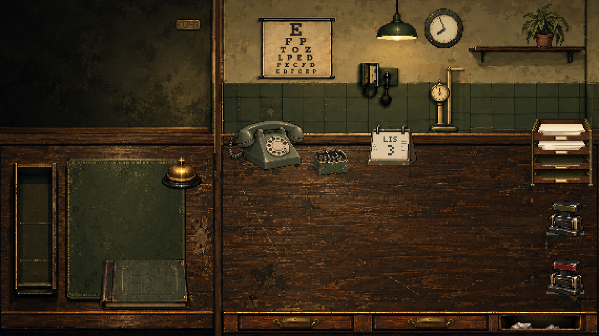

# Two desk drawers — 0.8.6

The right desk has two identical drawers followed by the wastebasket. The player chooses the contents of either drawer. Documents, clipped bundles, the rulebook, loose clips and retained banknotes use the same storage/retrieval rules in both. No document type is assigned to a particular compartment.

## Artwork and provenance

This revision reuses the original generated artwork, without creating a new illustration or substituting geometric furniture. `src/render/clinic.ts` first draws `public/assets/art/cabinet-workstation.png`, then copies its existing drawer rectangle `(216, 298, 123, 20)` to `(344, 298, 123, 20)` with `drawImage`. Source and destination dimensions are equal, all coordinates are integers, and image smoothing remains disabled. The copy fills the previously plain middle panel; the original drawer, desktops and wastebasket remain in place. Each drawer uses the same existing `drawer-interior.png` and stored-object sprites.

The built-in image generator produced these project-original assets. The retained sources, exact original prompts and offline preparation recipes are documented in [the workstation corrections](art-workstation-2026-10-25-corrections.md), [the workstation polish](art-workstation-2026-10-25-polish.md), and [the drawer and documents record](art-drawer-documents-2026-10-25.md). `scripts/prepare-workstation-polish.mjs` continues to reproduce the source cabinet; the deterministic runtime copy above is the complete additional compositing recipe. No acquired artwork or new redistribution terms are involved.

## Input and presentation

| Target | Empty-handed bounds | Compatible carried-item bounds |
| --- | --- | --- |
| Left drawer (`drawer`) | `(222,299,110,18)` | `(210,278,132,42)` |
| Right drawer (`drawer-2`) | `(350,299,110,18)` | `(342,278,126,42)` |
| Wastebasket | `(478,297,68,23)` | `(468,282,102,38)` |

Adjacent drop areas do not overlap. Canvas hit testing and semantic DOM controls share `dropTargetRect`. Both drawer controls have localized PL/EN names and announce their own item count. Empty-handed activation opens that drawer; activation while carrying stores in it. Escape and the bottom rim close it and restore focus to its own control. The same modal focus trap, filing order, 24-cover pagination, hover/focus names, object compartment, clock behavior and handling costs apply to both. Retrieval carries the selected object or complete bundle out.

`activeDrawer` and the visible page are temporary controller state. Papers and banknotes persist their physical location, while `drawerItems` holds one inventory per drawer. The rulebook remains one unique object. Both inventories survive day changes; cash keeps its existing once-per-day settlement behavior. See [save v31](save-format.md#version-31-two-independent-drawers).

## Verification

`tests/two-drawers.test.ts` exercises each drawer's bundles, filing order, independent pagination, manual/clip transfer, notes, cash and settlement, save validation, capacity and nonoverlapping targets. `tests/browser/drawer.spec.ts` checks identical rendered front pixels, PL/EN names, mouse/keyboard transfer, independent contents after save/import, focus restoration, tray referrals, bundles and cash. Existing paperwork, inspection, progression, clock, closing-time and welcome tests cover the shared behavior and release label.
